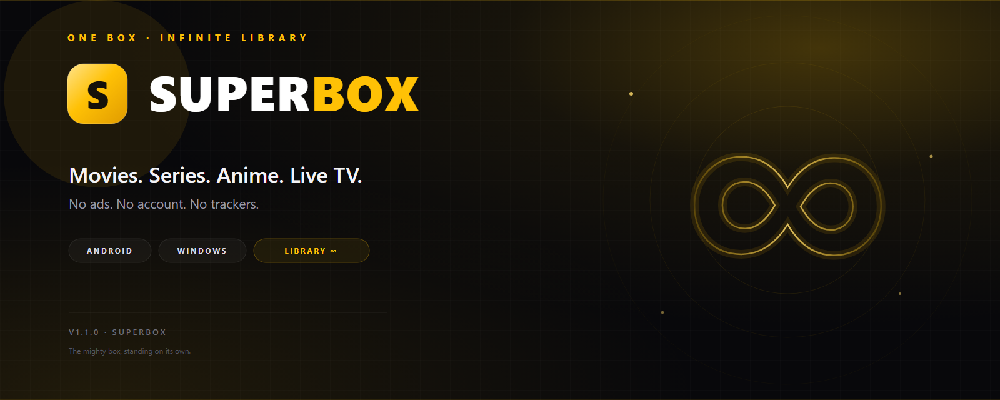
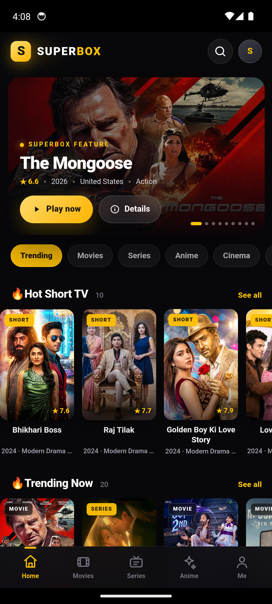
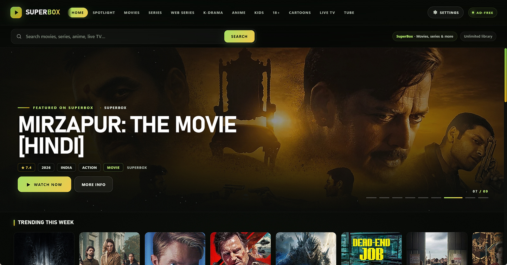
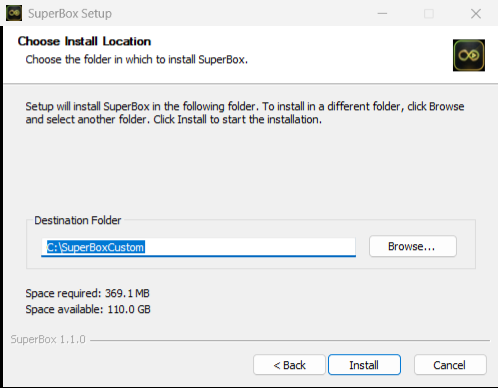
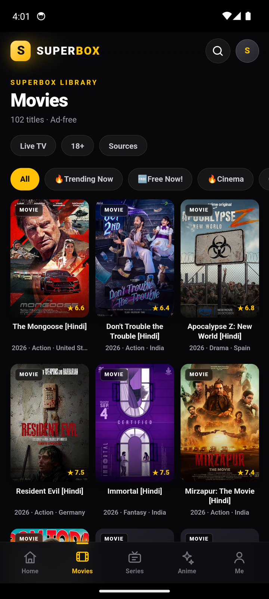
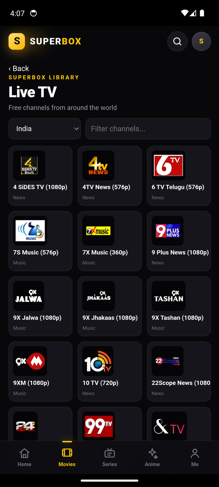
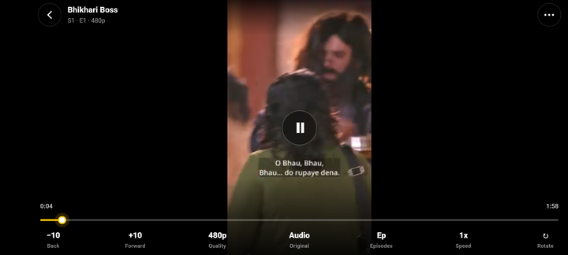
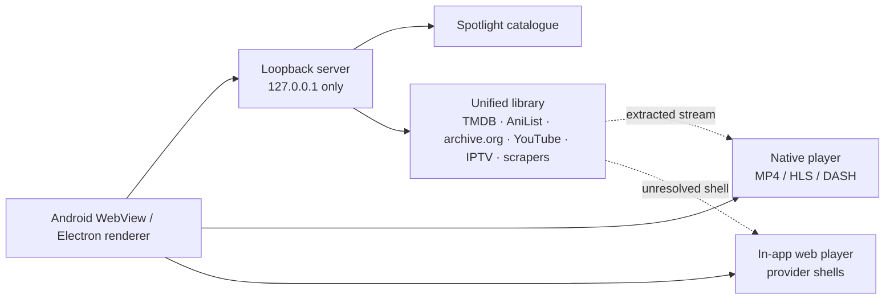

<div align="center">
  
  <br>
  <h1>SUPERBOX</h1>
  <p><b>The mighty box. One ad-free home for movies, series, anime and live TV.</b></p>
  <p>
    <a href="https://github.com/mohdziauddin2006-cloud/superbox/releases/latest"></a>
    <a href="https://github.com/mohdziauddin2006-cloud/superbox/actions/workflows/verify.yml"></a>
    
    
    <a href="https://github.com/mohdziauddin2006-cloud/superbox/releases"></a>
    <a href="https://github.com/mohdziauddin2006-cloud/superbox/stargazers"></a>
  </p>
  <p>
    <a href="https://github.com/mohdziauddin2006-cloud/superbox/releases/download/v1.1.0/SuperBox-Setup-1.1.0.exe"></a>
    &nbsp;
    <a href="https://github.com/mohdziauddin2006-cloud/superbox/releases/download/v1.1.0/SuperBox-1.1.0.apk"></a>
  </p>
  <p><sub>Windows 10/11 x64 &nbsp;·&nbsp; Android 6.0+ &nbsp;·&nbsp; Setup 121.5 MB &nbsp;·&nbsp; Portable 110.3 MB &nbsp;·&nbsp; APK 2.4 MB</sub></p>
  <p><sub>ONE LIBRARY &nbsp;·&nbsp; NATIVE HLS / DASH / MP4 &nbsp;·&nbsp; LIVE TV &nbsp;·&nbsp; ZERO ADS</sub></p>
</div>

<p align="center">
  <a href="#screens">Screens</a> &nbsp;·&nbsp;
  <a href="#download">Download</a> &nbsp;·&nbsp;
  <a href="#whats-new-in-110">What's new</a> &nbsp;·&nbsp;
  <a href="#two-apps-one-library">Features</a> &nbsp;·&nbsp;
  <a href="#one-library-every-source">Sources</a> &nbsp;·&nbsp;
  <a href="#build-from-source">Build</a>
</p>

---

## Screens

Real captures from the 1.1.0 builds on Android 14 and Windows 11.

<table>
  <tr>
    <td align="center" valign="top" width="34%">
      <br>
      <sub><b>Android APK</b> · Home</sub>
    </td>
    <td align="center" valign="top" width="66%">
      <br>
      <sub><b>Windows EXE</b> · Home</sub>
      <br><br>
      <br>
      <sub><b>Windows Setup</b> · install anywhere</sub>
    </td>
  </tr>
</table>

<table>
  <tr>
    <td align="center"><br><sub><b>One Library</b></sub></td>
    <td align="center"><br><sub><b>Live TV</b></sub></td>
    <td align="center"><br><sub><b>Native playback</b></sub></td>
  </tr>
</table>

## Download

| Build | Best for | Size | Get it |
|---|---|---:|---|
| **SuperBox Setup** `.exe` | Windows 10/11 x64 — normal wizard, any folder or drive | 121.5 MB | [Download](https://github.com/mohdziauddin2006-cloud/superbox/releases/download/v1.1.0/SuperBox-Setup-1.1.0.exe) |
| **SuperBox Portable** `.exe` | Windows 10/11 x64 — no install, run from anywhere | 110.3 MB | [Download](https://github.com/mohdziauddin2006-cloud/superbox/releases/download/v1.1.0/SuperBox-Portable-1.1.0.exe) |
| **SuperBox APK** | Android 6.0+ — universal, every ABI | 2.4 MB | [Download](https://github.com/mohdziauddin2006-cloud/superbox/releases/download/v1.1.0/SuperBox-1.1.0.apk) |

Everything is attached to the **[v1.1.0 release](https://github.com/mohdziauddin2006-cloud/superbox/releases/tag/v1.1.0)**,
together with `SHA256SUMS.txt`. Checksums and the signing certificate are
recorded in [docs/VERIFY.md](docs/VERIFY.md).

> [!TIP]
> **Windows:** the Setup build opens a normal wizard and lets you pick any
> folder or drive. The Portable build needs no installation. No admin required.
>
> **Android:** allow “Install unknown apps” for your browser or file manager,
> open the APK, and install. Play Protect may offer to scan the sideloaded app.

## What's new in 1.1.0

> [!NOTE]
> **1.1.0 is the unification release.** The separate Vault is gone and its
> catalogue now lives inside the normal Library. HLS/DASH playback is native,
> MP4 start time dropped from ~45 s to ~9 s, and the new infinity icon ships on
> both platforms. [Read the release notes →](docs/RELEASE_NOTES_v1.1.0.md)

## Two apps. One library.

SuperBox is a catalogue browser, not a media host. It brings several catalogues
together into one library and plays what the sources return.

| | |
|---|---|
| **Spotlight** | The front page: trending, cinema, series, anime, free-to-watch rows, hero carousel and search. |
| **One Library** | Every source now lives inside the normal Library. Movies, Series, Anime, Web Series, K-Drama, Kids, 18+, Cartoons, Live TV and Tube appear as rows and filter chips — no separate Vault section. |
| **Native player** | MP4 plays natively; HLS and DASH use bundled engines with recovery and fallback chains. Quality, audio, speed, seek, rotation and hardware Back are handled. |
| **Provider ladder** | When a provider shell never delivers media, SuperBox probes, retries once, then advances to the next source. |
| **Live TV** | Country, news, sports, movies, music and kids channels from public IPTV playlists. |
| **Sources, named** | A Library sources sheet lists every catalogue behind the app — no mystery boxes. |
| **Quiet by design** | No account, no ads, no telemetry, no watch history. Only internet and network-state permissions on Android. |
| **Touch-first** | Five-tab mobile navigation, oversized targets, bottom sheets and a layout built for one hand. |

## One library, every source

The old separate **SuperBox Vault** section is gone. Its catalogue, hero rows and
sources are merged into the Library tabs, so Movies, Series and Anime each mix
the Spotlight catalogue with the extra library rows. The chips on each tab
filter the combined set, and search covers both catalogues at once.

| Source | What it powers |
|---|---|
| **TMDB** | Movie and series metadata, artwork, discovery rows |
| **AniList** | Anime rows and search |
| **Internet Archive** | Classic cartoons and public-domain animation |
| **YouTube** | The ad-free Tube section |
| **iptv-org · Free-TV** | Live TV channel playlists |
| **XMaal · KatMovieHD · KDramasMaza · HindiDrama** | Web series, Indian cinema and K-drama |
| **Eporner · 123av · Rule34 · Hentaicity · Hentai.tv** | The opt-in 18+ filter |
| **Public embed providers** | Streams that cannot be extracted play in the in-app web player |

SuperBox does not host media. Titles, artwork and streams stay with their
sources. Availability depends on the source, your region and your network.

> **18+:** the adult filter is opt-in and clearly labelled. It is intended only
> for adults who are legally allowed to view such material in their jurisdiction.

## Install

### Windows 10/11

1. Download **SuperBox Setup** or **SuperBox Portable**.
2. Run it. The Setup wizard lets you choose any destination folder or drive.
3. If SmartScreen appears, choose **More info → Run anyway** — the indie build
   is signed for Android but not with a paid Windows code-signing certificate.
4. Launch SuperBox from the desktop shortcut or Start menu.

The Windows build targets x64. Windows 11 on ARM runs it through x64 emulation.

### Android 6.0+

1. Download **SuperBox-1.1.0.apk**.
2. Allow installs from unknown apps for the browser or file manager you use.
3. Open the APK and install.
4. The APK has no native libraries, so the single universal build works on ARM,
   ARM64, x86 and x86_64.

## Under the hood



Both apps keep the UI away from CORS and signing problems with a loopback-only
server. On Android that is `LocalServer.java` (ports 47821–47832); on Windows
it is `srv2.js` (ports 46901–46903). Read [docs/ARCHITECTURE.md](docs/ARCHITECTURE.md)
for the full picture, including the parallel range reader that makes large MP4
indexes arrive quickly.

On Android, privileged endpoints require a per-session token, first-party
scripts are obfuscated, and every `.js` asset is stored as AES-256-GCM
ciphertext and decrypted in memory by the local server.

## Build from source

**Desktop**

```powershell
cd desktop
npm install
npm start          # run
npm run dist       # NSIS + portable installers in ..\dist
```

**Android**

```powershell
cd android
Copy-Item build.local.example.ps1 build.local.ps1   # add your keystore details
.\build.ps1
```

Requirements: Node.js 20+, JDK 17, Android SDK platform 34, build-tools 34.0.0
and Python 3. The APK build is SDK-only — `aapt2`, `javac`, `d8`, `zipalign`
and `apksigner`, no Gradle.

## Repository map

```
android/            Kotlin-free Java shell + WebView UI + library assets
  assets/           app.js, library.js, sources.js, libraries.js, style.css
  src/              MainActivity, LocalServer, native player overlay
  res/              launcher icon, strings, theme
desktop/            Electron app
  main.js           window and lifecycle
  renderer.js       desktop UI and views
  srv2.js           proxy, resolver, stream extractor
  sources.js        library catalogue data
  libraries.js      library scrapers
build-resources/    app icons
docs/               banner, screenshots, architecture, verification
tools/              asset pipeline, icon generator, CDP smoke checks
```

## Verified, not vibes

The v1.1.0 artifacts were installed and tested, not just compiled:

- Home loads from the local snapshot immediately; cold app start measured
  **1.39 s** on the Android 14 emulator.
- Movies tab renders the merged library: **102 titles**, Live TV / 18+ /
  Sources chips, and library rows from every source.
- Live TV loads the full India playlist (**845 channels**) and a channel plays
  in the native player.
- Poster images retry automatically while the disk cache warms, so cards no
  longer stay stuck on their initials placeholder.
- YouTube/library fetches go through the local proxy; the CORS error spam is
  gone and the page renders without repeated direct requests.
- MP4 episode playback started in about **9 s** (previously ~45 s) after the
  first-byte window was reduced; HLS live TV and a 480p episode both played in
  the native player.
- Windows installer and portable builds launch, load the catalogue and report
  version **1.1.0**; the new infinity icon is embedded in both executables.
- APK signature verified with `apksigner`; `versionCode=2`, `versionName=1.1.0`,
  one `classes.dex`, no plain `.js` assets.

<details>
<summary><b>SHA-256 checksums</b></summary>

```
SuperBox-Setup-1.1.0.exe      53bb7baf06584e9777c54307af34480fefe2638ee76251c48c440269359c12cc
SuperBox-Portable-1.1.0.exe   ceea6ff4d7f0a9c7447f25a400313779a6349cf4e51b433938bef390cad14f19
SuperBox-1.1.0.apk            b9e4ce69a264223f3ee13cda456db01c3c543a25e9fa04b8901a6fd32274d0f4
```

APK signing certificate SHA-256:
`5a59f92f2526dbdd47b679510ac9ec1754aa479330f304b727997aafa2d82017`

Full details: [docs/VERIFY.md](docs/VERIFY.md).
</details>

## Privacy and fair use

- No account, no ads, no trackers, no watch history.
- Local proxies bind to `127.0.0.1` and die with the app.
- Privileged Android endpoints require a token generated for the current
  process; the token is injected into the page at load time.
- SuperBox does not host or re-host media. It indexes public catalogues and
  plays streams from third parties; rights remain with their owners.
- Use SuperBox for personal, lawful access only, and respect the laws and
  service terms that apply where you live.
- SuperBox is not affiliated with TMDB, AniList, Internet Archive, YouTube,
  iptv-org, Free-TV or any stream provider.

## License

Code is released under the [MIT License](LICENSE). Media, artwork and
third-party catalogues are not covered by that license.

---

<div align="center">
  <h3>If SuperBox earned a spot on your home screen, give it a star.</h3>
  <p>
    <a href="https://github.com/mohdziauddin2006-cloud/superbox/stargazers"><b>⭐ Star SuperBox</b></a>
    &nbsp;·&nbsp;
    <a href="https://github.com/mohdziauddin2006-cloud/superbox/releases/latest"><b>Download v1.1.0</b></a>
    &nbsp;·&nbsp;
    <a href="CHANGELOG.md"><b>Changelog</b></a>
  </p>
  <sub>One box. Infinite library. Built for touch.</sub>
</div>
