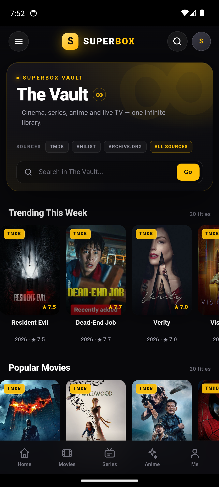
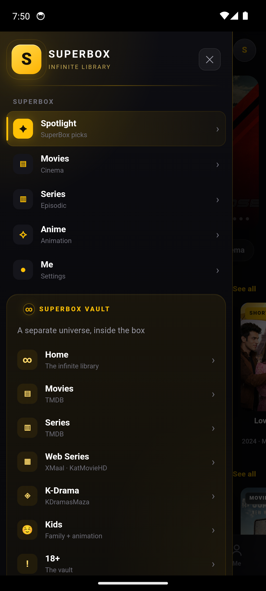
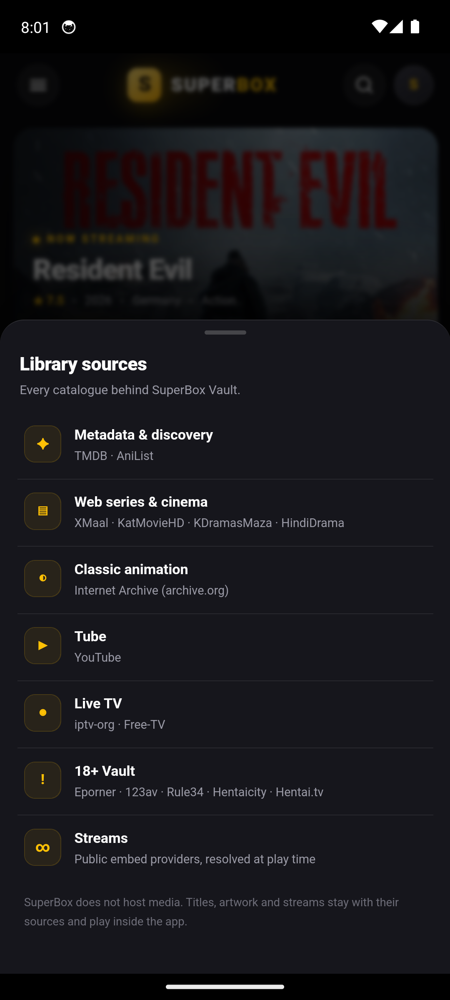
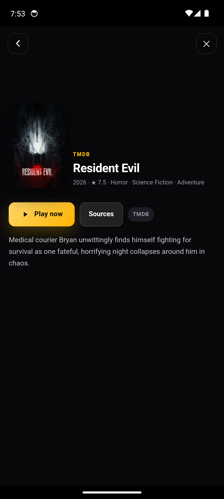
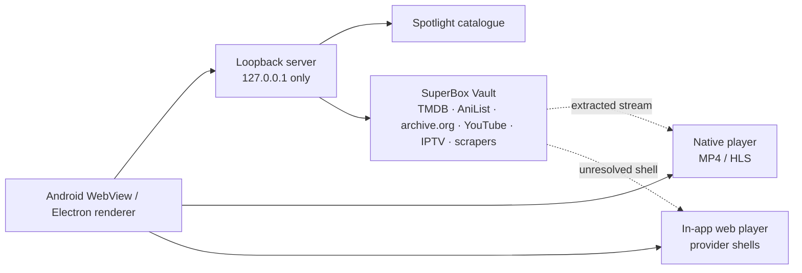

<div align="center">
  
  <br>
  <h1>SUPERBOX</h1>
  <p><b>The mighty box. One ad-free home for movies, series, anime and live TV.</b></p>
  <p>
    <a href="https://github.com/mohdziauddin2006-cloud/superbox/releases/latest"></a>
    <a href="https://github.com/mohdziauddin2006-cloud/superbox/actions/workflows/verify.yml"></a>
    
    
    <a href="https://github.com/mohdziauddin2006-cloud/superbox/releases"></a>
    <a href="https://github.com/mohdziauddin2006-cloud/superbox/stargazers"></a>
  </p>
  <p><sub>SPOTLIGHT &nbsp;·&nbsp; SUPERBOX VAULT &nbsp;·&nbsp; NATIVE PLAYER &nbsp;·&nbsp; LIVE TV &nbsp;·&nbsp; ZERO ADS</sub></p>
</div>

---

## Download

| Build | Best for | Size | Get it |
|---|---|---:|---|
| **SuperBox Setup** `.exe` | Windows 10/11 x64 — normal wizard, any folder or drive | 120.7 MB | [Download](https://github.com/mohdziauddin2006-cloud/superbox/releases/download/v1.0.0/SuperBox-Setup-1.0.0.exe) |
| **SuperBox Portable** `.exe` | Windows 10/11 x64 — no install, run from anywhere | 109.6 MB | [Download](https://github.com/mohdziauddin2006-cloud/superbox/releases/download/v1.0.0/SuperBox-Portable-1.0.0.exe) |
| **SuperBox APK** | Android 6.0+ — universal, every ABI | 145 KB | [Download](https://github.com/mohdziauddin2006-cloud/superbox/releases/download/v1.0.0/SuperBox-1.0.0.apk) |

Everything is attached to the **[v1.0.0 release](https://github.com/mohdziauddin2006-cloud/superbox/releases/tag/v1.0.0)**,
together with `SHA256SUMS.txt`. Checksums and the signing certificate are
recorded in [docs/VERIFY.md](docs/VERIFY.md).

> [!TIP]
> **Windows:** the Setup build opens a normal wizard and lets you pick any
> folder or drive. The Portable build needs no installation. No admin required.
>
> **Android:** allow “Install unknown apps” for your browser or file manager,
> open the APK, and install. Play Protect may offer to scan the sideloaded app.

## Screens

<table>
  <tr>
    <td width="72%"></td>
    <td width="28%"></td>
  </tr>
  <tr>
    <td colspan="2" align="center"><sub><b>Windows</b> — full catalogue, native playback, and a wizard that installs wherever you want.</sub></td>
  </tr>
</table>

<table>
  <tr>
    <td align="center"><br><sub><b>Spotlight</b></sub></td>
    <td align="center"><br><sub><b>The Vault ∞</b></sub></td>
    <td align="center"><br><sub><b>One brand, two worlds</b></sub></td>
    <td align="center"><br><sub><b>Named sources</b></sub></td>
  </tr>
</table>

<details>
<summary><b>More screens — Vault detail and playback</b></summary>
<br>
<table>
  <tr>
    <td align="center"><br><sub>Vault detail with Play now and Sources</sub></td>
    <td align="center"><br><sub>Native provider playback, 1080p</sub></td>
  </tr>
</table>
</details>

## Two apps. One library.

SuperBox is a catalogue browser, not a media host. It brings two catalogues
together and plays what the sources return.

| | |
|---|---|
| **Spotlight** | The front page: trending, cinema, series, anime, free-to-watch rows, hero carousel and search. |
| **SuperBox Vault** | A separate library with ten sections: Movies, Series, Web Series, K-Drama, Anime, Kids, 18+, Cartoons, Live TV and Tube. Its own drawer group, its own hero, its own aura. |
| **Native player** | Real MP4/HLS streams play in the native SuperBox player with quality, audio, speed, seek, rotation and hardware Back handled. |
| **Provider ladder** | When a provider shell never delivers media, SuperBox probes, retries once, then advances to the next source. |
| **Live TV** | Country, news, sports, movies, music and kids channels from public IPTV playlists. |
| **Sources, named** | A Library sources sheet lists every catalogue behind the Vault — no mystery boxes. |
| **Quiet by design** | No account, no ads, no telemetry, no watch history. Only internet and network-state permissions on Android. |
| **Touch-first** | Five-tab mobile navigation, oversized targets, bottom sheets and a layout built for one hand. |

## The Vault ∞

The Vault is deliberately not a sixth bottom tab. It is a separate universe
inside the same app: a gold-lit drawer group, an infinity hero, and a source
strip that tells you exactly where the library comes from.

| Source | What it powers |
|---|---|
| **TMDB** | Movie and series metadata, artwork, discovery rows |
| **AniList** | Anime rows and search |
| **Internet Archive** | Classic cartoons and public-domain animation |
| **YouTube** | The ad-free Tube section |
| **iptv-org · Free-TV** | Live TV channel playlists |
| **XMaal · KatMovieHD · KDramasMaza · HindiDrama** | Web series, Indian cinema and K-drama |
| **Eporner · 123av · Rule34 · Hentaicity · Hentai.tv** | The opt-in 18+ Vault |
| **Public embed providers** | Streams that cannot be extracted play in the in-app web player |

SuperBox does not host media. Titles, artwork and streams stay with their
sources. Availability depends on the source, your region and your network.

> **18+:** the adult Vault is clearly separated. It is intended only for adults
> who are legally allowed to view such material in their jurisdiction.

## Install

### Windows 10/11

1. Download **SuperBox Setup** or **SuperBox Portable**.
2. Run it. The Setup wizard lets you choose any destination folder or drive.
3. If SmartScreen appears, choose **More info → Run anyway** — the indie build
   is signed for Android but not with a paid Windows code-signing certificate.
4. Launch SuperBox from the desktop shortcut or Start menu.

The Windows build targets x64. Windows 11 on ARM runs it through x64 emulation.

### Android 6.0+

1. Download **SuperBox-1.0.0.apk**.
2. Allow installs from unknown apps for the browser or file manager you use.
3. Open the APK and install.
4. The APK has no native libraries, so it works on ARM, ARM64, x86 and x86_64.

## Under the hood



Both apps keep the UI away from CORS and signing problems with a loopback-only
server. On Android that is `LocalServer.java` (ports 47821–47832); on Windows
it is `srv2.js` (ports 46901–46903). Read [docs/ARCHITECTURE.md](docs/ARCHITECTURE.md)
for the full picture, including the parallel range reader that makes large MP4
indexes arrive quickly.

## Build from source

**Desktop**

```powershell
cd desktop
npm install
npm start          # run
npm run dist       # NSIS + portable installers in ..\dist
```

**Android**

```powershell
cd android
Copy-Item build.local.example.ps1 build.local.ps1   # add your keystore details
.\build.ps1
```

Requirements: Node.js 20+, JDK 17, Android SDK platform 34, build-tools 34.0.0
and Python 3. The APK build is SDK-only — `aapt2`, `javac`, `d8`, `zipalign`
and `apksigner`, no Gradle.

## Repository map

```
android/            Kotlin-free Java shell + WebView UI + Vault assets
  assets/           app.js, vault.js, sources.js, libraries.js, style.css
  src/              MainActivity, LocalServer, native player overlay
  res/              launcher icon, strings, theme
desktop/            Electron app
  main.js           window and lifecycle
  renderer.js       desktop UI and views
  srv2.js           proxy, resolver, stream extractor
  sources.js        Vault catalogue data
  libraries.js      Vault scrapers
build-resources/    app icons
docs/               banner, screenshots, architecture, verification
tools/              CDP smoke checks (development only)
```

## Verified, not vibes

The v1.0.0 artifacts were installed and tested, not just compiled:

- Spotlight: **226** cards on Home; Movies **103**, Series **115**, Anime **26**.
- Vault: **5 rows / 104 cards** on Home; Web Series **9 rows / 193 titles**;
  Live TV **17 groups / 200 channels**.
- Vault detail, Library sources and native 1080p playback verified on an
  Android 14 emulator.
- Windows installer wizard, custom install folder and installed app verified.
- APK signature verified with `apksigner`; zero old brand strings in the APK's
  text assets.

<details>
<summary><b>SHA-256 checksums</b></summary>

```
SuperBox-Setup-1.0.0.exe      1865CB030E1B8C3B207D03E6DD47D93DC80E23F6C68E7E3E71CE3F0BFCBD6F42
SuperBox-Portable-1.0.0.exe   2A017D45C16E7DD6D5C921725B3B6827DD230B1EBED36FAC100DBFE0D1739716
SuperBox-1.0.0.apk            A64E87A4668552FBBFFD3A26A8B50DCD6165C1E5E3728ECB7EF3D59C79971FF6
```

APK signing certificate SHA-256:
`5a59f92f2526dbdd47b679510ac9ec1754aa479330f304b727997aafa2d82017`

Full details: [docs/VERIFY.md](docs/VERIFY.md).
</details>

## Privacy and fair use

- No account, no ads, no trackers, no watch history.
- Local proxies bind to `127.0.0.1` and die with the app.
- SuperBox does not host or re-host media. It indexes public catalogues and
  plays streams from third parties; rights remain with their owners.
- Use SuperBox for personal, lawful access only, and respect the laws and
  service terms that apply where you live.
- SuperBox is not affiliated with TMDB, AniList, Internet Archive, YouTube,
  iptv-org, Free-TV or any stream provider.

## License

Code is released under the [MIT License](LICENSE). Media, artwork and
third-party catalogues are not covered by that license.

---

<div align="center">
  <h3>If SuperBox earned a spot on your home screen, give it a star.</h3>
  <p>
    <a href="https://github.com/mohdziauddin2006-cloud/superbox/stargazers"><b>⭐ Star SuperBox</b></a>
    &nbsp;·&nbsp;
    <a href="https://github.com/mohdziauddin2006-cloud/superbox/releases/latest"><b>Download v1.0.0</b></a>
    &nbsp;·&nbsp;
    <a href="CHANGELOG.md"><b>Changelog</b></a>
  </p>
  <sub>One box. Infinite aura. Built for touch.</sub>
</div>
