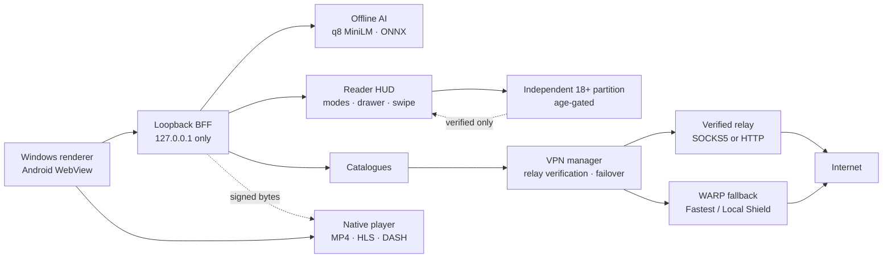

<div align="center">
  
  <br>
  <h1>SUPERBOX</h1>
  <p><b>A private desktop and Android library for films, series, anime, live TV and comics. On-device AI search, a verified multi-country VPN, no ads.</b></p>
  <p>
    
    
    
    
    
    
    
  </p>
  <p>
    <a href="https://github.com/mohdziauddin2006-cloud/superbox/releases/download/v1.4.1/SuperBox-Setup-1.4.1.exe"></a>
    &nbsp;
    <a href="https://github.com/mohdziauddin2006-cloud/superbox/releases/download/v1.4.1/SuperBox-1.4.1.apk"></a>
  </p>
  <p><sub>Windows 10/11 x64 &nbsp;·&nbsp; Android 6.0+ &nbsp;·&nbsp; Setup 237.1 MB &nbsp;·&nbsp; Universal APK 288.3 MB</sub></p>
  <p><sub>MOVIES &nbsp;·&nbsp; SERIES &nbsp;·&nbsp; ANIME &nbsp;·&nbsp; LIVE TV &nbsp;·&nbsp; READING &nbsp;·&nbsp; OFFLINE AI &nbsp;·&nbsp; VERIFIED VPN &nbsp;·&nbsp; ZERO ADS</sub></p>
</div>

<p align="center">
  <a href="#whats-new-in-141">What's new</a> &nbsp;·&nbsp;
  <a href="#download">Download</a> &nbsp;·&nbsp;
  <a href="#the-vpn">VPN</a> &nbsp;·&nbsp;
  <a href="#offline-search">AI search</a> &nbsp;·&nbsp;
  <a href="#reading">Reading</a> &nbsp;·&nbsp;
  <a href="#architecture">Architecture</a> &nbsp;·&nbsp;
  <a href="#controls--reader-shortcuts">Controls</a> &nbsp;·&nbsp;
  <a href="#sha-256-verification">Verify</a> &nbsp;·&nbsp;
  <a href="#build-from-source">Build</a>
</p>

---

## What's new in 1.4.1

The region switch is no longer a label on a single tunnel. SuperBox now discovers
public relays, proves that each one exits in the country it claims, and routes
the app through the healthy result. The same release finishes the glass
interface, the updater and the Android transport work.

- **Working country egress.** UK, US, Japan, Germany, Australia, Singapore,
  Canada, Netherlands, France and India. Relays are checked against two
  independent HTTPS endpoints before use, so a proxy that rewrites traffic is
  rejected instead of trusted.
- **Live connection facts.** The panel shows the verified egress IP, country,
  city, relay address and a ticking `HH:MM:SS` uptime. If the relay drops, the
  app fails over to the next healthy candidate.
- **WARP, renamed honestly.** Cloudflare WARP is now **Fastest / Local Shield
  (WARP)** and remains the fallback when relay discovery finds nothing usable.
  It is no longer presented as a country selector.
- **VPN OFF means direct.** Turning the VPN off removes the Chromium rules, the
  Node dispatcher and the Android proxy target, so traffic returns to the
  system route immediately.
- **Android parity.** `VpnManager` performs the same discovery, verification,
  caching and failover. Because a WebView cannot speak SOCKS5, `LocalServer`
  adds a loopback CONNECT tunnel and forwards absolute-URI requests through the
  active relay.
- **Glass interface, both themes.** Frosted panels, animated hero slides and
  spring transitions, with light and dark palettes checked for WCAG AA text
  contrast. The preference persists across launches.
- **Instant home.** The window paints while the tunnel connects in the
  background, instead of holding the first frame behind the VPN gate.
- **Updater with real verification.** `window.SB_UPDATER` and the update modal
  download the release asset, stream it to disk, verify its SHA-256 before an
  install button appears, and re-check the digest before launch.
- **Resilient artwork and episodes.** Every poster has a local proxy and a
  public resizer fallback. Episode lists paginate in ranges of 50 from the real
  season total, and range switches never duplicate rows.
- **Isolated AI partitions.** Safe and 18+ vectors live in separate stores.
  A test item written to the isolated store never appeared in safe search.

## What it does

| Capability | Windows | Android | Notes |
|---|:---:|:---:|---|
| Film, series, anime and live TV catalogues | ● | ● | native adapters plus an in-app shell |
| MP4, HLS and DASH playback | ● | ● | quality and audio selection, signed URLs preserved |
| Offline ONNX semantic search | ● | ● | q8 MiniLM, 384 dimensions, no API key |
| Separate safe and 18+ indexes | ● | ● | hard partition; adult items never enter safe |
| Scoped search on every surface | ● | ● | deep results require the age gate |
| Reading HUD and chapter drawer | ● | ● | paged, vertical and continuous modes |
| Episode range pagination | ● | ● | `1–50`, `51–100`, `101+`, season selector |
| Verified multi-country VPN | ● | ● | SOCKS5/HTTP relays, egress proof, failover |
| WARP fallback | ● | ● | labelled Fastest / Local Shield |
| In-app updater with SHA-256 | ● | — | desktop release asset |
| Light and dark themes | ● | ● | persisted; contrast checked |
| Zero ads and zero telemetry | ● | ● | no account, no trackers, no watch history |

## Download

| Build | Platform | Architecture | Size | Get it |
|---|---|---|---:|---|
| **SuperBox Setup** `.exe` | Windows 10/11 | x64 | 237.1 MB | [Download](https://github.com/mohdziauddin2006-cloud/superbox/releases/download/v1.4.1/SuperBox-Setup-1.4.1.exe) |
| **SuperBox APK** | Android 6.0+ | `arm64-v8a` · `armeabi-v7a` · `x86` · `x86_64` | 288.3 MB | [Download](https://github.com/mohdziauddin2006-cloud/superbox/releases/download/v1.4.1/SuperBox-1.4.1.apk) |

Both files are attached to the **[v1.4.1 release](https://github.com/mohdziauddin2006-cloud/superbox/releases/tag/v1.4.1)**
with `SHA256SUMS.txt`. The Windows build is an NSIS setup wizard, not a portable
archive. The APK is one universal file signed with the SuperBox release key and
contains all four ABIs, the ONNX model, the tokenizer and the native decoders.

## The VPN

SuperBox ships two transports and chooses between them in this order.

1. **Relay mode.** The app collects public SOCKS5 and HTTP relays for the
   requested country, tests them concurrently, and keeps only the ones that
   answer the Cloudflare trace endpoint with the expected country.
   Each candidate must also answer a second TLS host with the same egress IP;
   a relay that returns different addresses is treated as untrusted. Healthy
   relays are cached, and the newest request wins when the country changes
   during a scan.
2. **Fastest / Local Shield (WARP).** If no relay passes, the app can start its
   bundled Cloudflare WARP client. This is a real tunnel, but anycast means the
   exit country cannot be promised, so the interface does not claim one.

When a relay is active, the panel reports the verified egress IP, country, city
and relay endpoint. The uptime counter starts at `00:00:00` and ticks once per
second. A watchdog checks the tunnel; if it stops answering, the app rotates to
another verified relay before showing a failure.

**Desktop routing.** Chromium receives explicit `socks5://host:port` or
`http=host:port;https=host:port` rules. Node traffic uses a global `undici`
dispatcher. Loopback and the local BFF stay direct. The previous rules are
cleared when the VPN is turned off.

**Android routing.** `VpnManager` owns discovery, verification, caching and
failover. The WebView cannot use SOCKS5 directly, so `LocalServer` exposes a
local CONNECT tunnel and forwards requests through the active relay. Switching
off restores the direct proxy target.

Public relays are third-party infrastructure. They can be slow, rate-limited or
taken offline without notice, which is why the app verifies before use and keeps
more than one candidate. The app does not log browsing history.

## Offline search

Recommendations and search run on the device.

- **Model:** `Xenova/all-MiniLM-L6-v2`, quantized to q8 ONNX, bundled with its
  tokenizer and vocabulary in both builds.
- **Runtime:** `onnxruntime-node` on Windows; the bundled ONNX runtime and WASM
  on Android, served from the app's loopback origin.
- **No cloud call:** the loader uses `local_files_only: true`. There is no
  inference endpoint and no key to configure.
- **Two stores:** safe and 18+ documents are embedded and persisted separately.
  The index API rejects an adult item in the safe store, and the isolated store
  stays empty until the 18+ vault is unlocked.
- **Measured on the packaged build:** safe index with 762 documents; warm
  semantic searches answered in 9–19 ms; the similar section painted 16 unique
  cards in about 112 ms; an isolated test document was deduplicated on re-index
  and never appeared in safe results.
- **Fallback:** if the ONNX runtime cannot load, a local TF-IDF engine answers
  instead of disabling search.

## Reading

- Three reader modes: paged, vertical and continuous.
- A chapter drawer that preserves the current page and does not reload the
  catalogue.
- Arrow keys page left and right in paged modes; `C` opens the chapter drawer.
- Touch swipe with a tap guard, so accidental taps do not turn a page.
- English-only filtering for the English lane. Chapters without a hosted page
  are omitted rather than opening a blank reader.
- The 18+ shelf is reachable only through **18+ Reading** and the age gate. It
  is absent from standard Reading, Kids and the safe search index.

## Interface

The shell uses translucent panels over a moving hero backdrop. The search bar,
settings dialog and VPN drawer all use backdrop blur, and card hover states use
short spring curves rather than linear fades. Both themes are token-driven:
dark uses a near-black base with gold accents, light uses warm paper surfaces
with darker text tokens. Text contrast was audited on home, detail, settings and
VPN surfaces in both themes, including the hero pills and the VPN status rows.

`prefers-reduced-motion` is honoured. When it is set, transitions collapse to
near-zero duration and the hero does not animate.

<details id="architecture">
<summary><b>Architecture</b></summary>

<br>



Both apps keep the UI away from CORS and signing problems with a loopback-only
server. Windows uses ports `46901–46903`; Android uses `47821–47832`. Proxied
requests follow the active VPN transport, except for the scoped media CDN path
that rejects VPN egress.

On Android, privileged endpoints require a per-session token, first-party
scripts are obfuscated, and every `.js` asset is stored as AES-256-GCM
ciphertext and decrypted in memory by the local server. The token is injected
into the page at serve time.

Relay discovery is split into a provider layer and a verification layer. The
provider layer normalizes public lists into `host:port` candidates with a
protocol and country hint. The verification layer opens the proxy, requests the
Cloudflare trace endpoint and a second TLS endpoint, compares the reported IPs,
and only then marks the candidate healthy. Results are cached per country under
the app data directory, so a restart does not begin with an empty pool.

</details>

<details id="controls--reader-shortcuts">
<summary><b>Controls &amp; Reader Shortcuts</b></summary>

<br>

| Context | Input | Action |
|---|---|---|
| Reader, paged modes | `←` / `→` | previous or next page |
| Reader, any mode | `C` | open or close the chapter drawer |
| Reader, touch | horizontal or vertical swipe | move one page or one viewport |
| Reader, touch | tap | show or hide the HUD |
| Player | `Back` button | close the player |
| Player | Play, Prev Ep, Next Ep, Mute, Fullscreen | transport controls |
| Overlays | `Esc` | close the open menu, age gate or catalogue directory |
| Search | `Enter` | submit the current query |
| Search | Safe / 18+ pills | switch scope; 18+ asks for the age gate |
| VPN panel | power control | connect, disconnect or reconnect |
| VPN panel | region cards | pick a country; scan cancels the previous one |

The player also responds to its on-screen transport controls and closes with
the Back button. Episode range tabs are keyboard reachable and keep the active
range visible.

</details>

<details id="sha-256-verification">
<summary><b>SHA-256 Verification</b></summary>

<br>

| Artifact | Bytes | SHA-256 |
|---|---:|---|
| `SuperBox-Setup-1.4.1.exe` | 248,664,675 | `D72EFC55CF2E9F40FDD4AB8F683DC816DF4C29F57147E61BB446C7331BCF8CFF` |
| `SuperBox-1.4.1.apk` | 302,262,719 | `14246D09DC9C5A6080525B614D895172EB5DBBC941ED6CDE36576D7D1ABE92D8` |

Windows PowerShell:

```powershell
Get-FileHash .\SuperBox-Setup-1.4.1.exe -Algorithm SHA256
Get-FileHash .\SuperBox-1.4.1.apk -Algorithm SHA256
```

Linux, macOS or Termux:

```bash
sha256sum SuperBox-Setup-1.4.1.exe
sha256sum SuperBox-1.4.1.apk
```

The same two lines are published in `SHA256SUMS.txt` on the release page. The
in-app updater verifies the downloaded installer against the checksum file
before it offers to install, and verifies it again before launch. A mismatch
aborts the update and keeps the current installation.

</details>

<details id="build-from-source">
<summary><b>Build From Source</b></summary>

<br>

**Windows**

```powershell
cd desktop
npm install
npm start          # run from source
npm run dist       # NSIS installer in ..\dist
```

**Android**

```powershell
cd android
Copy-Item build.local.example.ps1 build.local.ps1   # add keystore details
.\build.ps1
```

Requirements: Node.js 20 or newer, JDK 17, Android SDK platform 34,
build-tools 34.0.0 and Python 3. The APK build is SDK-only: it calls `aapt2`,
`javac`, `d8`, `zipalign` and `apksigner` directly, with no Gradle. The offline
model, tokenizer, ONNX runtime, FFmpeg decoders and native VPN cores are bundled
by the build scripts.

The Android build reads signing details from `build.local.ps1` or the
environment. The file is git-ignored. Without it the build stops rather than
producing an unsigned release.

**Repository map**

```text
android/               Java shell, WebView UI, relay manager, reader
  assets/              app shell, libraries, reader, offline AI bundle
  src/                 MainActivity, LocalServer, VpnManager, player
  res/                 launcher icon, strings, theme
desktop/               Electron app
  main.js              window, lifecycle, Chromium proxy, updater IPC
  renderer.js          desktop UI, age gate, search, views, player wiring
  reading.js           reading catalogues, readers and HUD
  libraries.js         catalogue client, scoped search, episode wiring
  ai-recommend.js      ONNX / TF-IDF engine and vector partitions
  relay.js             relay discovery, verification, cache, failover
  srv2.js              BFF, VPN routes, resolver and media proxy
  vpn.js               WARP and relay lifecycle, status and watchdog
  models/              bundled q8 ONNX model and tokenizer
build-resources/       app icons
docs/                  hero artwork and architecture notes
tools/                 asset pipeline and verification suites
```

</details>

## Privacy and fair use

- No account, no ads, no trackers and no watch history.
- Local proxies bind to `127.0.0.1` and stop with the app.
- Android privileged routes require a token generated for the current process
  and injected into the page at load time.
- The WARP client registers anonymously with Cloudflare. Relay mode uses public
  relays; those operators can see connection metadata, as with any VPN.
- Catalogue names and endpoints are resolved inside the app. The interface
  shows catalogues, not raw provider URLs.
- SuperBox does not host or re-host media. It indexes public catalogues and
  plays streams from third parties. Rights remain with their owners.
- Use SuperBox for personal, lawful access and follow the laws and service
  terms that apply where you live.
- SuperBox is not affiliated with any catalogue, metadata service, CDN, VPN
  provider or rights holder.

## License

Code is released under the [MIT License](LICENSE). Media, artwork and
third-party catalogues are not covered by that license. Bundled third-party
components remain under their own licenses.

---

<div align="center">
  
  <h3>One box. Infinite library.</h3>
  <p>
    <a href="https://github.com/mohdziauddin2006-cloud/superbox/stargazers"><b>Star SuperBox</b></a>
    &nbsp;·&nbsp;
    <a href="https://github.com/mohdziauddin2006-cloud/superbox/releases/tag/v1.4.1"><b>Download v1.4.1</b></a>
    &nbsp;·&nbsp;
    <a href="CHANGELOG.md"><b>Changelog</b></a>
  </p>
  <sub>Built for touch. Tuned for quiet. Zero ads.</sub>
</div>
