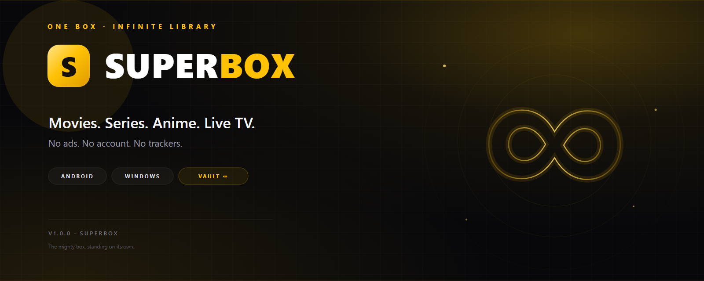
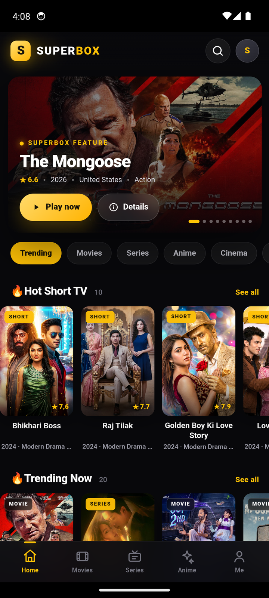
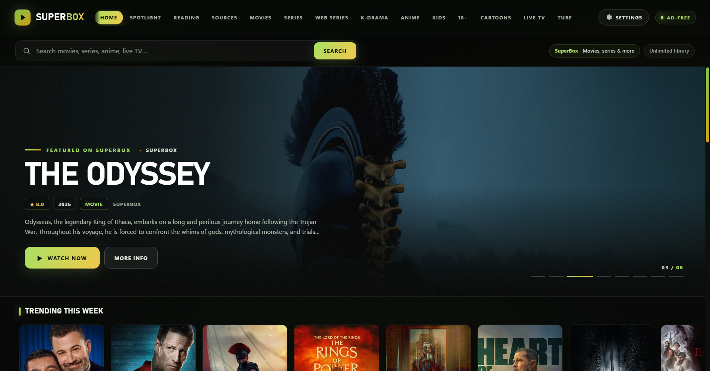
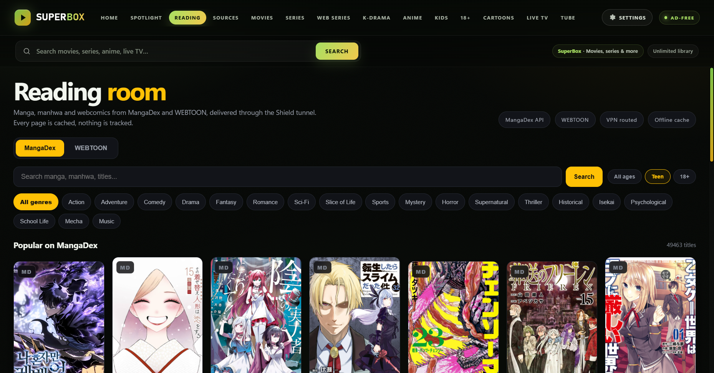
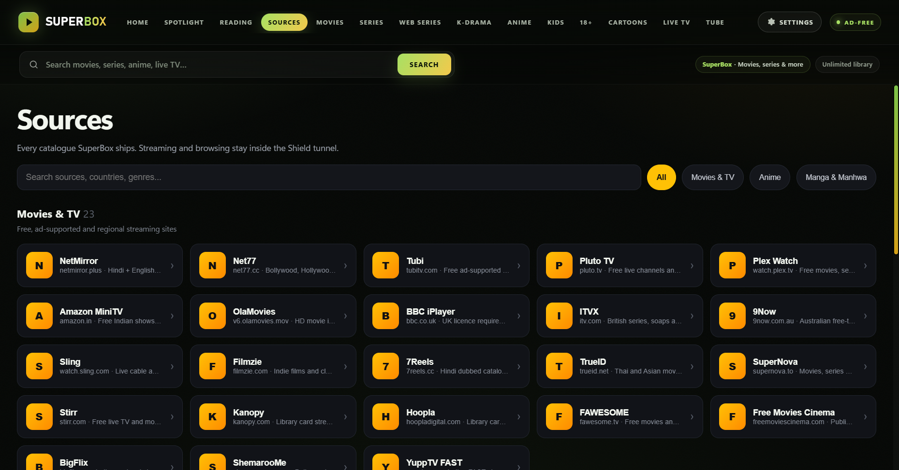
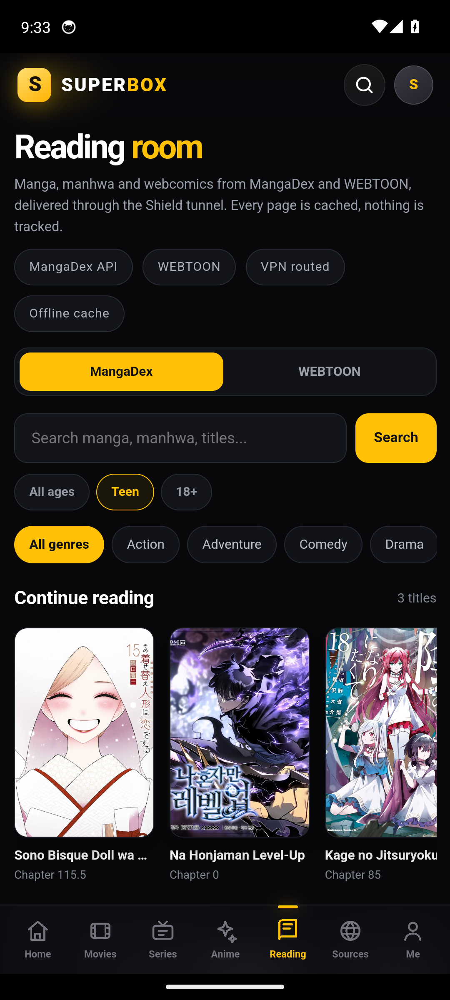
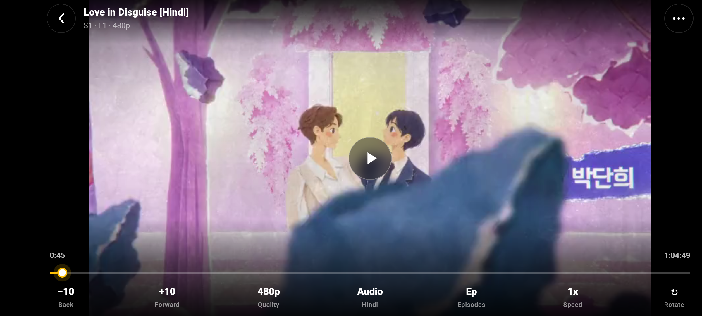
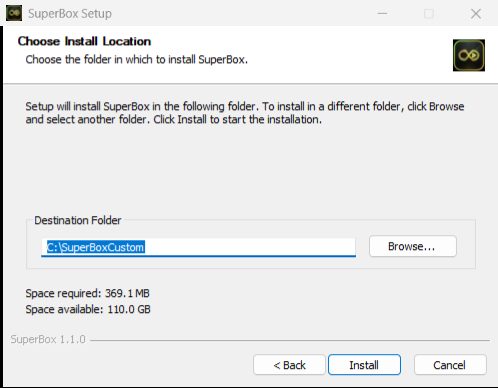
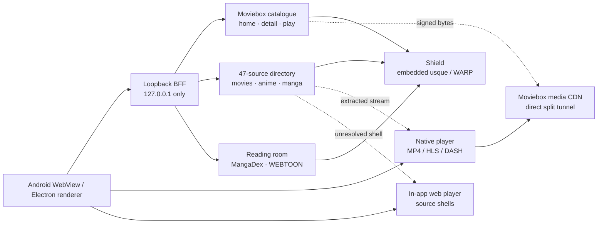

<div align="center">
  
  <br>
  <h1>SUPERBOX</h1>
  <p><b>One ad-free box for movies, series, anime, live TV and 47 streaming &amp; reading sources — wrapped in an embedded, open-source global VPN.</b></p>
  <p>
    <a href="https://github.com/mohdziauddin2006-cloud/superbox/releases/latest"></a>
    <a href="https://github.com/mohdziauddin2006-cloud/superbox/actions/workflows/verify.yml"></a>
    
    
    <a href="https://github.com/mohdziauddin2006-cloud/superbox/releases"></a>
    <a href="https://github.com/mohdziauddin2006-cloud/superbox/stargazers"></a>
  </p>
  <p>
    <a href="https://github.com/mohdziauddin2006-cloud/superbox/releases/download/v1.3.0/SuperBox-Setup-1.3.0.exe"></a>
    &nbsp;
    <a href="https://github.com/mohdziauddin2006-cloud/superbox/releases/download/v1.3.0/SuperBox-1.3.0.apk"></a>
  </p>
  <p><sub>Windows 10/11 x64 &nbsp;·&nbsp; Android 6.0+ &nbsp;·&nbsp; Setup 119.8 MB &nbsp;·&nbsp; universal APK 264.6 MB</sub></p>
  <p><sub>MOVIES &nbsp;·&nbsp; SERIES &nbsp;·&nbsp; ANIME &nbsp;·&nbsp; LIVE TV &nbsp;·&nbsp; MANGA &nbsp;·&nbsp; ZERO ADS &nbsp;·&nbsp; EMBEDDED VPN</sub></p>
</div>

<p align="center">
  <a href="#screens">Screens</a> &nbsp;·&nbsp;
  <a href="#download">Download</a> &nbsp;·&nbsp;
  <a href="#whats-new-in-130">What's new</a> &nbsp;·&nbsp;
  <a href="#the-shield-embedded-vpn">Shield VPN</a> &nbsp;·&nbsp;
  <a href="#one-library-every-source">Sources</a> &nbsp;·&nbsp;
  <a href="#reading-room">Reading</a> &nbsp;·&nbsp;
  <a href="#build-from-source">Build</a>
</p>

---

## Screens

Real captures from the 1.3.0 builds on Android 14 and Windows 11.

<table>
  <tr>
    <td align="center" valign="top" width="32%">
      <br>
      <sub><b>Android APK</b> · Spotlight home</sub>
    </td>
    <td align="center" valign="top" width="68%">
      <br>
      <sub><b>Windows Setup</b> · Spotlight home with live VPN status</sub>
    </td>
  </tr>
</table>

<table>
  <tr>
    <td align="center" valign="top" width="50%">
      <br>
      <sub><b>Reading room</b> · MangaDex catalogue, 49,463 titles</sub>
    </td>
    <td align="center" valign="top" width="50%">
      <br>
      <sub><b>Sources</b> · 47 catalogues, three groups</sub>
    </td>
  </tr>
</table>

<table>
  <tr>
    <td align="center"><br><sub><b>Android</b> · Reading room</sub></td>
    <td align="center"><br><sub><b>Android</b> · Moviebox playback, 480p</sub></td>
    <td align="center"><br><sub><b>Windows Setup</b> · install anywhere</sub></td>
  </tr>
</table>

## Download

| Build | Best for | Size | Get it |
|---|---|---:|---|
| **SuperBox Setup** `.exe` | Windows 10/11 x64 — normal wizard, any folder or drive | 119.8 MB | [Download](https://github.com/mohdziauddin2006-cloud/superbox/releases/download/v1.3.0/SuperBox-Setup-1.3.0.exe) |
| **SuperBox APK** | Android 6.0+ — universal fat build, every ABI | 264.6 MB | [Download](https://github.com/mohdziauddin2006-cloud/superbox/releases/download/v1.3.0/SuperBox-1.3.0.apk) |

Everything is attached to the **[v1.3.0 release](https://github.com/mohdziauddin2006-cloud/superbox/releases/tag/v1.3.0)**,
together with `SHA256SUMS.txt`. Checksums and package details are recorded in
[docs/VERIFY.md](docs/VERIFY.md).

> [!TIP]
> **Windows:** the Setup build opens a normal wizard and lets you pick any
> folder or drive. No admin required.
>
> **Android:** allow “Install unknown apps” for your browser or file manager,
> open the APK, and install. Play Protect may offer to scan the sideloaded app.

## What's new in 1.3.0

> [!NOTE]
> **1.3.0 is the everywhere release.** SuperBox now ships its own VPN instead
> of asking you to install one: an embedded, open-source Cloudflare WARP
> tunnel gates the app, routes every request and switches region pools per
> source. Moviebox is back with Spotlight, detail pages and native playback.
> All 47 sources from `source.txt` are integrated, and a full **Reading room**
> brings MangaDex and WEBTOON into the same shell with cached, VPN-routed
> pages. [Read the release notes →](docs/RELEASE_NOTES_v1.3.0.md)

## Two apps. One library.

SuperBox is a catalogue browser, not a media host. It brings several catalogues
together into one library and plays what the sources return.

| | |
|---|---|
| **Shield VPN** | An embedded `usque` client (open-source Cloudflare WARP/MASQUE, GPL-3.0) starts with the app, registers anonymously, and refuses to unlock the UI until the tunnel is genuinely up. 13 region profiles, 12 endpoint profiles each, automatic per-source selection and a kill switch for every proxied request. |
| **Spotlight** | Moviebox-powered front page: hero carousel, trending, cinema, series, anime, free-to-watch rows and search — restored on both platforms. |
| **Moviebox playback** | Detail pages with seasons, episodes and audio tracks; quality ladder from 480p to 1080p; Range-based media proxy with a direct split tunnel for the CDN that rejects WARP. |
| **47 sources** | Every movie/TV, anime and manga site in `source.txt`, named, searchable and grouped. Stable APIs get native rows; everything else opens in the VPN-routed in-app browser. |
| **Reading room** | MangaDex + WEBTOON native readers, all genres, all ages and an 18+ filter. Covers and pages are cached through the Shield tunnel. |
| **Native player** | MP4 plays natively; HLS and DASH use bundled engines with recovery and fallback chains. Quality, audio, speed, seek, rotation and hardware Back are handled. |
| **Provider ladder** | When a provider shell never delivers media, SuperBox probes, retries once, then advances to the next source. |
| **Live TV** | Country, news, sports, movies, music and kids channels from public IPTV playlists. |
| **Quiet by design** | No account, no ads, no telemetry, no watch history. The local proxies bind to loopback and die with the app. |
| **Touch-first** | Five-tab mobile navigation, oversized targets, bottom sheets and a layout built for one hand. |

## The Shield: embedded VPN

The VPN is not a recommendation and not an external app. It is part of both
builds.

- **Engine:** [`usque`](https://github.com/Diniboy1123/usque) v4.2.1
  (GPL-3.0), speaking Cloudflare WARP over MASQUE. Anonymous registration;
  no account, email or personal details.
- **Desktop:** a hidden `usque l4-http-proxy` process on `127.0.0.1:46950`.
  Node's `fetch` goes through an `undici` proxy agent; Chromium goes through
  `session.setProxy`. Loopback is bypassed so the app can still talk to its
  own BFF.
- **Android:** the same engine is bundled per ABI as `libusque.so` and exposed
  as a local HTTP proxy. `LocalServer` sends upstream requests through it, and
  `androidx.webkit` `ProxyController` routes the WebView through it too.
- **Truthful status:** the app reports the requested region *and* the actual
  egress country. Cloudflare WARP is anycast, so a region chooses the endpoint
  pool; it cannot promise a country. The UI never pretends otherwise.
- **Region pools:** Global (automatic), United States, Canada, United Kingdom,
  Australia, India, Germany, Japan, Singapore, Hong Kong, South Korea, France
  and Brazil — 12 endpoint profiles per region, rotated for redundancy.
- **Non-disruptive switching:** per-source region preferences are applied when
  the tunnel is down. A healthy tunnel is never torn down mid-session just to
  chase a region.
- **Kill switch:** when the tunnel is down, gated API calls fail closed and the
  UI stays behind the Shield screen.
- **Split tunnel, deliberately:** Moviebox's media CDN rejects WARP egress with
  `427 Forbidden`. Its catalogue, API, artwork and source pages stay behind the
  tunnel; the signed media bytes are fetched directly with `Range` + `Referer`.
  This is scoped to that CDN only.

> [!IMPORTANT]
> The VPN needs a working network and a few seconds to connect. If Cloudflare's
> endpoint pool is unreachable, SuperBox shows the error instead of silently
> browsing unprotected.

## One library, every source

47 unique sources, exactly matching [`source.txt`](source.txt): **23 movies &
TV**, **10 anime**, **14 manga & manhwa**. The Sources tab lists every one with
its region and what it is good for; the search box filters names, countries and
notes.

### Movies & TV — 23

| Source | Region | What it powers |
|---|---|---|
| **NetMirror** | IN | Hindi + English movies and series |
| **Net77** | IN | Bollywood, Hollywood and web series |
| **Tubi** | US | Free ad-supported movies and TV |
| **Pluto TV** | US | Free live channels and on demand |
| **Plex Watch** | UK | Free movies, series and live TV |
| **Amazon MiniTV** | IN | Free Indian shows and films |
| **OlaMovies** | IN | HD movie index, multi-language |
| **BBC iPlayer** | UK | UK licence required for playback |
| **ITVX** | UK | British series, soaps and films |
| **9Now** | AU | Australian free-to-air streaming |
| **Sling** | US | Live cable and on demand |
| **Filmzie** | UK | Indie films and classics |
| **7Reels** | IN | Hindi dubbed catalogue |
| **TrueID** | TH | Thai and Asian movies |
| **SuperNova** | US | Movies, series and anime |
| **Stirr** | US | Free live TV and movies |
| **Kanopy** | US | Library card streaming |
| **Hoopla** | US | Library card movies, comics and audio |
| **FAWESOME** | US | Free movies and series |
| **Free Movies Cinema** | US | Public-domain and indie films |
| **BigFlix** | IN | Indian regional cinema |
| **ShemarooMe** | IN | Bollywood and Gujarati theatre |
| **YuppTV FAST** | IN | Indian FAST channels |

### Anime — 10

| Source | Region | What it powers |
|---|---|---|
| **AniWaves** | Global | Anime streams and schedule |
| **9Anime** | Global | Sub and dub catalogue |
| **AnimeVillage** | Global | Anime episodes and movies |
| **Miruro** | Global | Fast anime streaming |
| **AniWatch** | Global | Anime with dubs |
| **Yomi** | Global | Anime and manga |
| **AllManga** | Global | Anime streams and manga |
| **AniFlix** | Global | Anime catalogue |
| **AniMixPlay** | Global | Anime aggregator |
| **HiAnime** | Global | Anime sub and dub |

### Manga & Manhwa — 14

| Source | Region | What it powers |
|---|---|---|
| **MangaDex** | Global | Open API, millions of chapters — native reader |
| **WEBTOON** | Global | Official vertical comics — native reader |
| **Asura Scans** | Global | Manhwa and manhua |
| **Flame Comics** | Global | Manhwa translations |
| **Vortex Scans** | Global | Manhwa and manhua |
| **HiveToons** | Global | Manhwa, manhua and comics |
| **Comix** | Global | Aggregated manga and manhwa |
| **ManhuaUS** | Global | Manhua and manhwa |
| **NeloManga** | Global | Manga, manhwa and manhua |
| **Tappytoon** | Global | Official manhwa (paid chapters) |
| **Tapas** | Global | Webcomics and novels |
| **MangaFire** | Global | Large manga index |
| **ToonSutra** | IN | Indian comics and manhwa |
| **Hentai20** | Global | Adults only — 18+ filter |

SuperBox does not host media. Titles, artwork and streams stay with their
sources. Availability depends on the source, your region and your network.

> **18+:** the adult filter is opt-in and clearly labelled. It is intended only
> for adults who are legally allowed to view such material in their jurisdiction.

## Reading room

The Reading tab is a first-class reader, not a web shortcut.

- **Two native catalogues:** MangaDex through its public API and WEBTOON's
  official catalogue, with search, genre chips and age filters (All ages,
  Teen, 18+).
- **Cached pages:** every cover and page is fetched through the local `/img`
  cache, behind the Shield tunnel, with MIME sniffing that rejects anti-bot
  HTML instead of showing a broken image.
- **Real readers:** vertical webtoon mode and paged manga mode, chapter
  navigation, keyboard/gesture paging, progress saved locally.
- **Honest fallbacks:** official-only chapters that expose no page images show
  an **External chapter** card with the publisher link. WEBTOON's own reader
  can still open in-app.
- **Resilient covers:** MangaDex's at-home cover host is learned once and
  cached, so covers keep loading when the CDN rotates.
- **47-source directory:** every other manga site opens in the VPN-routed
  in-app browser, one tap from the Sources tab.

## Under the hood



Both apps keep the UI away from CORS and signing problems with a loopback-only
server. On Android that is `LocalServer.java` (ports 47821–47832); on Windows
it is `srv2.js` (ports 46901–46903). Every proxied request goes through the
Shield, except the scoped Moviebox media split. Read
[docs/ARCHITECTURE.md](docs/ARCHITECTURE.md) for the full picture, including
the parallel range reader that makes large MP4 indexes arrive quickly.

On Android, privileged endpoints require a per-session token, first-party
scripts are obfuscated, and every `.js` asset is stored as AES-256-GCM
ciphertext and decrypted in memory by the local server.

## Verified, not vibes

The 1.3.0 artifacts were built, installed and exercised, not just compiled:

| Check | Result |
|---|---|
| Windows install | NSIS Setup installed to `C:\Program Files\SuperBox`; app reports **1.3.0** |
| Windows Shield | gate hidden, `warp=ON`, egress reported truthfully (`IN`) |
| Windows Moviebox | Spotlight hero, 50 cards, 16 rows, detail with episodes |
| Windows playback | `readyState=4`, 1152×480, muted, closed cleanly |
| Windows Reading | 24 cards, 32 chapters, real page rendered at 768×1024 |
| Windows sources | 47 cards in 3 groups; iframe opens `netmirror.plus` |
| Windows WEBTOON | 30 cards, 30 covers, 10 chapters |
| Android package | universal APK, 277,497,277 B, `versionCode=4`, four ABIs |
| Android Shield | bundled usque, `ready egress=IN warp=true`, gate blocks the UI |
| Android Moviebox | `/raw` served 2 MB then 8 MB windows as `206 video/mp4`; real 480p frame decoded (`C2GoldfishAvcDec`, 850×480) |
| Android Reading | 49,463 MangaDex titles, real covers, detail and chapter list; external-only chapter handled cleanly |
| Media ceiling | no test stream ran longer than 9 seconds |
| APK signature | `apksigner verify` passes v1/v2/v3 |

<details>
<summary><b>SHA-256 checksums</b></summary>

```
SuperBox-Setup-1.3.0.exe   a21067ccc181088f62a03538fd3e4840b07b8bcdd6eecf191d4e2428875ad778
SuperBox-1.3.0.apk         1bb79e6230a9eedb8dd54e6cfa5a9e29f1d85eab764032ab607eadda0e4c4d6b
```

APK signing certificate SHA-256:
`5a59f92f2526dbdd47b679510ac9ec1754aa479330f304b727997aafa2d82017`

Full details: [docs/VERIFY.md](docs/VERIFY.md).
</details>

## Install

### Windows 10/11

1. Download **SuperBox Setup**.
2. Run it. The Setup wizard lets you choose any destination folder or drive.
3. If SmartScreen appears, choose **More info → Run anyway** — the indie build
   is signed for Android but not with a paid Windows code-signing certificate.
4. Launch SuperBox from the desktop shortcut or Start menu. Wait for the Shield
   screen to turn into the app; that is the VPN confirming it is up.

The Windows build targets x64. Windows 11 on ARM runs it through x64 emulation.

### Android 6.0+

1. Download **SuperBox-1.3.0.apk**.
2. Allow installs from unknown apps for the browser or file manager you use.
3. Open the APK and install.
4. The APK is a universal fat build with `arm64-v8a`, `armeabi-v7a`, `x86`
   and `x86_64` libraries, so one file covers phones, tablets and emulators.

## Build from source

**Desktop**

```powershell
cd desktop
npm install
npm start          # run
npm run dist       # NSIS installer in ..\dist
```

**Android**

```powershell
cd android
Copy-Item build.local.example.ps1 build.local.ps1   # add your keystore details
.\build.ps1
```

Requirements: Node.js 20+, JDK 17, Android SDK platform 34, build-tools 34.0.0
and Python 3. The APK build is SDK-only — `aapt2`, `javac`, `d8`, `zipalign`
and `apksigner`, no Gradle. The Android build also bundles the `usque` binary
per ABI; see [docs/ARCHITECTURE.md](docs/ARCHITECTURE.md) for the VPN wiring.

## Repository map

```
android/            Java shell + WebView UI + bundled VPN + reader assets
  assets/           app.js, reading.js, sources-hub.js, style and icons
  src/              MainActivity, LocalServer, VpnManager, native player
  res/              launcher icon, strings, theme
desktop/            Electron app
  main.js           window and lifecycle
  renderer.js       desktop UI and views
  srv2.js           BFF, Shield routes, Moviebox resolver and media proxy
  vpn.js            usque lifecycle, region pools, status
  reading.js        MangaDex / WEBTOON catalogue and reader
  sources-hub.js    the 47-source directory
build-resources/    app icons
docs/               banner, screenshots, architecture, verification, notes
tools/              asset pipeline, icon generator, CDP verification suites
source.txt          the canonical source list
```

## Privacy and fair use

- No account, no ads, no trackers, no watch history.
- The VPN registers anonymously with Cloudflare WARP; no personal details are
  sent. `usque` is open source and the traffic path is auditable.
- Local proxies bind to `127.0.0.1` and die with the app.
- Privileged Android endpoints require a token generated for the current
  process; the token is injected into the page at load time.
- SuperBox does not host or re-host media. It indexes public catalogues and
  plays streams from third parties; rights remain with their owners.
- Use SuperBox for personal, lawful access only, and respect the laws and
  service terms that apply where you live.
- SuperBox is not affiliated with Moviebox, TMDB, AniList, MangaDex, WEBTOON,
  Cloudflare, Internet Archive, YouTube, iptv-org, Free-TV or any stream
  provider.

## License

Code is released under the [MIT License](LICENSE). Media, artwork and
third-party catalogues are not covered by that license. The bundled `usque`
binary remains under its own GPL-3.0 license.

---

<div align="center">
  <h3>If SuperBox earned a spot on your home screen, give it a star.</h3>
  <p>
    <a href="https://github.com/mohdziauddin2006-cloud/superbox/stargazers"><b>⭐ Star SuperBox</b></a>
    &nbsp;·&nbsp;
    <a href="https://github.com/mohdziauddin2006-cloud/superbox/releases/latest"><b>Download v1.3.0</b></a>
    &nbsp;·&nbsp;
    <a href="CHANGELOG.md"><b>Changelog</b></a>
  </p>
  <sub>One box. Infinite library. Built for touch.</sub>
</div>
