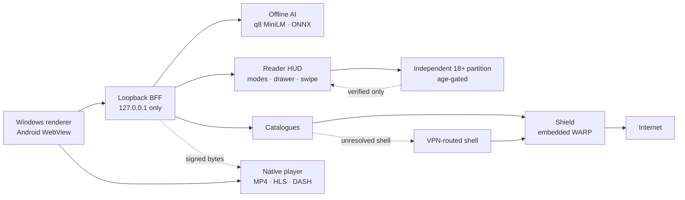

<div align="center">
  
  <br>
  <h1>SUPERBOX</h1>
  <p><b>One private box for everything you watch and read — with offline AI recommendations, an embedded global VPN, and zero ads.</b></p>
  <p>
    
    
    
    
    
    
    
  </p>
  <p>
    <a href="https://github.com/mohdziauddin2006-cloud/superbox/releases/download/v1.4.0/SuperBox-Setup-1.4.0.exe"></a>
    &nbsp;
    <a href="https://github.com/mohdziauddin2006-cloud/superbox/releases/download/v1.4.0/SuperBox-1.4.0.apk"></a>
  </p>
  <p><sub>Windows 10/11 x64 &nbsp;·&nbsp; Android 6.0+ &nbsp;·&nbsp; Setup 237.1 MB &nbsp;·&nbsp; universal APK 288.2 MB</sub></p>
  <p><sub>MOVIES &nbsp;·&nbsp; SERIES &nbsp;·&nbsp; ANIME &nbsp;·&nbsp; LIVE TV &nbsp;·&nbsp; READING &nbsp;·&nbsp; OFFLINE AI &nbsp;·&nbsp; EMBEDDED VPN &nbsp;·&nbsp; ZERO ADS</sub></p>
</div>

<p align="center">
  <a href="#whats-new-in-140">What's new</a> &nbsp;·&nbsp;
  <a href="#download">Download</a> &nbsp;·&nbsp;
  <a href="#offline-intelligence">Offline AI</a> &nbsp;·&nbsp;
  <a href="#reading-refined">Reading</a> &nbsp;·&nbsp;
  <a href="#the-shield-embedded-vpn">Shield VPN</a> &nbsp;·&nbsp;
  <a href="#architecture">Architecture</a> &nbsp;·&nbsp;
  <a href="#verified-in-140">Verified</a> &nbsp;·&nbsp;
  <a href="#build-from-source">Build</a>
</p>

---

## What's new in 1.4.0

**1.4.0 is the intelligence release.** The AI Studio backend is now part of both
apps, recommendations run entirely on-device, the reader gained a complete HUD,
and every catalogue ships behind one private shell.

<table>
  <tr>
    <td align="center" width="25%" valign="top">
      <h3>∞</h3>
      <b>Offline AI</b><br>
      <sub>Quantized MiniLM embeddings, bundled for Windows and Android. No API key, no cloud call.</sub>
    </td>
    <td align="center" width="25%" valign="top">
      <h3>◐</h3>
      <b>Reader HUD</b><br>
      <sub>Every reading mode, a chapter drawer, keyboard paging and swipe, with strict language filtering.</sub>
    </td>
    <td align="center" width="25%" valign="top">
      <h3>◉</h3>
      <b>Shield control</b><br>
      <sub>Power control, live latency, Auto-Region and a searchable region picker in one panel.</sub>
    </td>
    <td align="center" width="25%" valign="top">
      <h3>⌁</h3>
      <b>One search</b><br>
      <sub>Safe and deep search share one bar. Deep results stay behind the age gate.</sub>
    </td>
  </tr>
</table>

- **Offline recommendations.** `all-MiniLM-L6-v2` in q8 ONNX form is bundled
  with its tokenizer and loaded with `local_files_only: true`. Matching runs in
  a separate vector partition per audience, returns 12–16 previews with match
  pills, and answers warm queries in about 20 ms.
- **A real reader HUD.** Modes for paged, vertical and continuous reading; a
  chapter drawer; keyboard arrows, page keys and swipe; and English-only
  chapter filtering that never paints a stale page.
- **Episode pagination that scales.** Seasons plus `1–50`, `51–100`, `101+`
  range tabs, with a non-blocking catalogue fallback when the primary metadata
  service is slow or unavailable.
- **Scoped search everywhere.** Every search surface can scope itself and clear
  in one tap; deep search opens through the same age verification used by the
  private vault.
- **Every catalogue activated.** Native adapters, detail pages, chapter lists
  and readers for the complete catalogue set, with desktop and Android parity.
  Raw provider endpoints are resolved inside the app and are never shown in the
  interface.
- **A private adult vault.** Adult catalogues live in a separate registry and a
  separate vector partition, appear beside each other only inside **18+
  Reading**, and are absent from standard Reading and Kids. A dedicated **18+
  Video** search is isolated the same way.
- **VPN control, finished.** A status chip, pulse ring, power copy, manual
  ON/OFF, latency badge, Auto-Region switch and searchable region cards replace
  the old one-way indicator.
- **Stability pass.** The merged backend now guards `undici` and `TLSSocket`
  failures, every outbound request has a timeout and a retry budget, and a
  dropped socket can no longer take down the app.

## Feature matrix

| Capability | Windows | Android | Notes |
|---|:---:|:---:|---|
| Offline ONNX recommendations | ● | ● | q8 MiniLM, 384-dim embeddings, local files only |
| Separate safe / 18+ vectors | ● | ● | hard partition enforcement; adult items never enter safe |
| Reader HUD and chapter drawer | ● | ● | modes, progress, chapter jump, keyboard or swipe |
| Scoped safe / deep search | ● | ● | deep results require age verification |
| Episode range pagination | ● | ● | `1–50` · `51–100` · `101+`, plus season selector |
| Non-blocking metadata fallback | ● | ● | cached catalogue answers while upstream recovers |
| VPN power panel | ● | ● | manual ON/OFF, latency, Auto-Region, region search |
| Native video player | ● | ● | MP4 · HLS · DASH, quality and audio ladders |
| Universal APK | — | ● | `arm64-v8a` · `armeabi-v7a` · `x86` · `x86_64` |
| Zero ads / zero telemetry | ● | ● | no account, no trackers, no watch history |

## Offline intelligence

Recommendations are local by design.

- **Model:** `Xenova/all-MiniLM-L6-v2`, quantized to q8 ONNX (about 23 MB),
  shipped with `config.json`, tokenizer files and vocabulary in both builds.
- **Runtime:** `onnxruntime-node` on Windows; the bundled browser ESM runtime
  and asyncify WASM on Android, served from the app's own loopback origin.
- **No network:** the loader passes `local_files_only: true`. There is no
  inference API and no key to configure.
- **Two partitions:** safe metadata and adult metadata are embedded and stored
  separately. The index API refuses to place an adult item in the safe store,
  and the mobile build mirrors that rule.
- **Fast handoff:** a candidate shortlist is embedded in batches of 16, then the
  query is a single dense pass. Cold indexing of 16 titles took about 42 ms on
  the reference Windows machine; a warm recommendation pass took about 10 ms.
  On Android, the first pass was about 151 ms and the second about 19 ms.
- **Useful output:** 12–16 preview cards, each with a percentage match pill,
  joining the existing similar section instead of replacing the page.

## Reading, refined

The Reading room remains a first-class reader, not a browser shortcut.

- **Three ways to read:** paged manga, vertical comic and a continuous mode,
  with the HUD adapting to each.
- **Chapter drawer:** every chapter in one sheet, current position preserved,
  and one-tap jumps that do not reload the catalogue.
- **Input parity:** arrow keys, Page Up/Down, Space and Home/End on desktop;
  horizontal or vertical swipe on touch, with a guard against accidental taps.
- **Strict English filtering:** feeds request the selected language, hosted
  pages are verified, and chapters without hosted pages are omitted rather than
  opening a blank reader.
- **Catalogue coverage:** native catalogues, chapter lists, lazy covers and
  ordered page extraction for every reading catalogue in the build. A fallback
  chain handles JavaScript-only chapters and anti-bot interstitials.
- **Safe by default:** standard Reading and Kids contain no adult items. The
  private adult shelf is reachable only through **18+ Reading** and the age
  gate, and its search is separate from the standard search index.

## The Shield: embedded VPN

The VPN is part of both builds, not an app you install first.

- **Engine:** open-source Cloudflare WARP over MASQUE, anonymously registered.
  No account, email or personal details.
- **Desktop:** a hidden local proxy, an `undici` agent for Node and
  `session.setProxy` for Chromium. Loopback stays direct.
- **Android:** a bundled native core exposed as a loopback HTTP proxy, with the
  WebView routed through it by `ProxyController`.
- **Control panel:** state chip, pulse ring, power copy, manual ON/OFF, live
  latency badge, Auto-Region switch and a searchable card list of regions.
- **Truthful status:** the panel reports the requested region *and* the actual
  egress when known. Anycast regions choose an endpoint pool; the UI never
  promises a country it cannot prove.
- **Fail closed:** gated calls fail when the tunnel is down. Manual OFF switches
  the app to direct routing deliberately instead of leaving requests pointed at
  a stopped proxy.
- **Scoped split tunnel:** one media CDN rejects WARP egress, so its signed
  bytes are fetched directly while its catalogue, artwork and metadata stay
  behind the tunnel. The exception is scoped to that CDN only.

> [!IMPORTANT]
> The Shield needs a working network and a few seconds to connect. If the
> endpoint pool is unreachable, SuperBox shows the error instead of browsing
> unprotected.

## Architecture



Both apps keep the UI away from CORS and signing problems with a loopback-only
server. Windows uses ports `46901–46903`; Android uses `47821–47832`. Every
proxied request goes through the Shield, except the scoped media exception.
On Android, privileged endpoints require a per-session token, first-party
scripts are obfuscated, and every `.js` asset is stored as AES-256-GCM
ciphertext and decrypted in memory by the local server.

## Download

| Build | Best for | Architecture | Size | Get it |
|---|---|---|---:|---|
| **SuperBox Setup** `.exe` | Windows 10/11 — normal wizard, any folder or drive | x64 | 237.1 MB | [Download](https://github.com/mohdziauddin2006-cloud/superbox/releases/download/v1.4.0/SuperBox-Setup-1.4.0.exe) |
| **SuperBox APK** | Android 6.0+ — one universal build | `arm64-v8a` · `armeabi-v7a` · `x86` · `x86_64` | 288.2 MB | [Download](https://github.com/mohdziauddin2006-cloud/superbox/releases/download/v1.4.0/SuperBox-1.4.0.apk) |

Everything is attached to the **[v1.4.0 release](https://github.com/mohdziauddin2006-cloud/superbox/releases/tag/v1.4.0)**,
together with `SHA256SUMS.txt`.

### SHA-256

| Artifact | Bytes | SHA-256 |
|---|---:|---|
| `SuperBox-Setup-1.4.0.exe` | 248,648,081 | `4CEF93A4A7C3693529C957FE9A3A33BDCB9F505ED09FE82564C5E390420FF955` |
| `SuperBox-1.4.0.apk` | 302,201,211 | `3003157DE51DBAD052433B70AE5023FE05C89521A4CAEAA617231451A9D1EDD4` |

```text
4CEF93A4A7C3693529C957FE9A3A33BDCB9F505ED09FE82564C5E390420FF955  SuperBox-Setup-1.4.0.exe
3003157DE51DBAD052433B70AE5023FE05C89521A4CAEAA617231451A9D1EDD4  SuperBox-1.4.0.apk
```

> [!TIP]
> **Windows:** run the Setup wizard and pick any folder or drive. No admin
> rights are required.
>
> **Android:** allow “Install unknown apps” for your browser or file manager,
> open the APK, and install. One file covers phones, tablets and emulators.

## Verified in 1.4.0

Every check below ran headless or in a hidden window, with audio muted and no
media stream allowed to run longer than ten seconds.

| Check | Result |
|---|---|
| Desktop AI engine | `mode=onnx`, `Xenova/all-MiniLM-L6-v2`, 384-dimensional vectors |
| Desktop indexing | 16 titles embedded in 42 ms cold; re-index skipped inference |
| Desktop recommendation | 16 previews, first match pill 98%, 10 ms warm |
| Android AI engine | bundled ONNX loaded in 907 ms; 384-dimensional vectors |
| Android recommendation | first pass 151 ms, warm pass 19 ms, 95% top match |
| Vector isolation | safe index populated; isolated index empty unless 18+ is active |
| Reader surfaces | HUD modes, chapter drawer, keyboard and swipe handlers present |
| Search surfaces | scoped inputs and clear controls on every search bar |
| Episode ranges | `1–50`, `51–100`, `101+` generated from season totals |
| VPN panel | power control, pulse ring, latency badge, Auto-Region, region search |
| Catalogue adapters | ordered pages and chapter lists returned within the cap |
| JavaScript syntax | every desktop and Android bundle passes `node --check` |
| Android Java | `LocalServer`, activity, VPN and player sources compile |
| APK package | universal, `versionCode=5`, four ABIs, ONNX assets, signature verified |
| Media ceiling | every verification stream muted and stopped under 10 s |

The complete artifact hashes are in the table above and in `SHA256SUMS.txt` on
the release page.

## Install

### Windows 10/11

1. Download **SuperBox-Setup-1.4.0.exe**.
2. Run the wizard and choose any destination folder or drive.
3. If SmartScreen appears, choose **More info → Run anyway**. The indie build is
   signed for Android but not with a paid Windows code-signing certificate.
4. Launch SuperBox. The Shield screen becomes the app once the tunnel is up.

The Windows build targets x64. Windows 11 on ARM runs it through x64 emulation.

### Android 6.0+

1. Download **SuperBox-1.4.0.apk**.
2. Allow installs from unknown apps for the browser or file manager you use.
3. Open the APK and install.
4. The universal APK contains `arm64-v8a`, `armeabi-v7a`, `x86` and `x86_64`
   libraries, so the same file runs on phones, tablets and emulators.

## Build from source

**Windows**

```powershell
cd desktop
npm install
npm start          # run
npm run dist       # NSIS installer in ..\dist
```

**Android**

```powershell
cd android
Copy-Item build.local.example.ps1 build.local.ps1   # add keystore details
.\build.ps1
```

Requirements: Node.js 20+, JDK 17, Android SDK platform 34, build-tools 34.0.0
and Python 3. The APK build is SDK-only — `aapt2`, `javac`, `d8`, `zipalign`
and `apksigner`, with no Gradle. The offline model, tokenizer, ONNX runtime and
native VPN cores are bundled by the build.

## Repository map

```text
android/               Java shell + WebView UI + bundled VPN + reader
  assets/              app shell, reader HUD, libraries, offline AI bundle
  src/                 MainActivity, LocalServer, VpnManager, native player
  res/                 launcher icon, strings, theme
desktop/               Electron app
  main.js              window and lifecycle
  renderer.js          desktop UI, age gate, search and views
  reading.js           reading catalogue, readers and HUD
  libraries.js         SBAI client, scoped search and episode wiring
  ai-recommend.js      ONNX / TF-IDF engine and vector partitions
  srv2.js              BFF, Shield routes, resolver and media proxy
  vpn.js               WARP lifecycle, regions and status
  models/              bundled q8 ONNX model and tokenizer
build-resources/       app icons
docs/                  hero, architecture and verification notes
tools/                 asset pipeline and verification suites
```

## Privacy and fair use

- No account, no ads, no trackers, no watch history.
- The VPN registers anonymously with Cloudflare WARP; no personal details are
  sent. The client is open source and the traffic path is auditable.
- Local proxies bind to `127.0.0.1` and die with the app.
- Privileged Android endpoints require a token generated for the current
  process and injected into the page at load time.
- Provider names and endpoints are resolved inside the app. The interface
  exposes catalogues, not raw provider URLs.
- SuperBox does not host or re-host media. It indexes public catalogues and
  plays streams from third parties; rights remain with their owners.
- Use SuperBox for personal, lawful access only, and respect the laws and
  service terms that apply where you live.
- SuperBox is not affiliated with any catalogue, metadata service, CDN, VPN
  provider or rights holder.

## License

Code is released under the [MIT License](LICENSE). Media, artwork and
third-party catalogues are not covered by that license. Bundled third-party
components remain under their own licenses.

---

<div align="center">
  
  <h3>One box. Infinite library.</h3>
  <p>
    <a href="https://github.com/mohdziauddin2006-cloud/superbox/stargazers"><b>⭐ Star SuperBox</b></a>
    &nbsp;·&nbsp;
    <a href="https://github.com/mohdziauddin2006-cloud/superbox/releases/tag/v1.4.0"><b>Download v1.4.0</b></a>
    &nbsp;·&nbsp;
    <a href="CHANGELOG.md"><b>Changelog</b></a>
  </p>
  <sub>Built for touch. Tuned for quiet. Zero ads.</sub>
</div>
