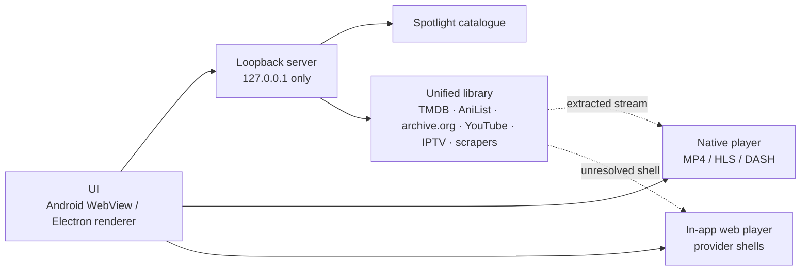

# How SuperBox works

SuperBox ships as two shells around the same idea: a small local server keeps
the UI free of CORS and signing problems, and a native player handles real
media while provider shells fall back to an in-app web view.

## Android

| Piece | Role |
|---|---|
| `MainActivity.java` | WebView host, immersive player overlay, provider ladder, stall probe and retry |
| `LocalServer.java` | Loopback bridge on ports 47821–47832: packaged assets, token-gated API/image/stream proxies, HLS/DASH rewrite, disk cache |
| `assets/app.js` | Spotlight UI, search, details, episodes, player controls |
| `assets/library.js` | Unified library rows, sources sheet, detail and resolution (`window.LIB`) |
| `assets/sources.js` | Library catalogue data (TMDB, AniList, archive.org, XMaal, KatMovieHD, KDramasMaza, live TV, 18+) |
| `assets/libraries.js` | Library scrapers (HTML in, items or streams out) |
| `assets/style.css` | Mobile visual system, including the gold aura and unified library surfaces |

The WebView never talks to the open internet for catalogue calls. Every request
goes through `127.0.0.1`, which adds the required client token and referer and
returns clean JSON or media.

Privileged routes (`/api/`, `/page`, `/extract`, `/tmdb/`, `/img`, `/stream`,
`/raw`, `/hls`, `/hlsseg`, `/dash`, `/dashseg`) require a per-session token. The
server injects it into `index.html` as `window.__SB_TOKEN__`, and a small fetch
wrapper signs every same-origin request — relative or absolute — before it
leaves the renderer. Requests without the token get `403`.

First-party scripts are obfuscated during the build. Every `.js` asset is stored
as AES-256-GCM ciphertext (`SBX1` magic, 12-byte IV, 16-byte tag); the key lives
in the generated `BuildSecrets.java`, and `LocalServer` decrypts each file in
memory when the WebView asks for it.

## Windows

| Piece | Role |
|---|---|
| `desktop/main.js` | Electron window, tray/menu, local server lifecycle |
| `desktop/preload.js` | Narrow IPC bridge |
| `desktop/renderer.js` | Desktop UI, catalogue views, playback |
| `desktop/srv2.js` | Loopback proxy on ports 46901–46903, Spotlight resolver, provider extractor, parallel range reader |
| `desktop/sources.js`, `desktop/libraries.js` | Library catalogue and scrapers |
| `desktop/hls.min.js` | Vendored HLS support |

The parallel range reader matters: some CDNs throttle a single connection to
roughly 60–120 KB/s, and an 8–9 MB MP4 index would otherwise take minutes to
arrive. The proxy splits the range into chunks, fetches them concurrently and
returns a normal `206` in order.

## Playback ladder

1. A library title maps to a provider URL.
2. The native overlay opens the first provider shell.
3. If the shell never delivers media, a stall probe retries once after 12 s,
   then advances to the next provider.
4. A real MP4/HLS/DASH URL plays in the native player. An unresolvable shell
   stays in the in-app web player.

Spotlight streams use the catalogue's signed play payload and play natively.

## Privacy model

- No account, no telemetry, no watch history.
- The proxies bind to `127.0.0.1` and are destroyed with the app.
- Artwork and media are fetched on demand; nothing is re-hosted.
- The Android app requests only internet and network-state permissions.

## Design language

SuperBox uses a near-black surface, a single warm gold light source and the
infinity mark as the app signature. The desktop edition uses the same dark
surface with a lime highlight. Both are built for touch or pointer, with large
targets and restrained motion.
