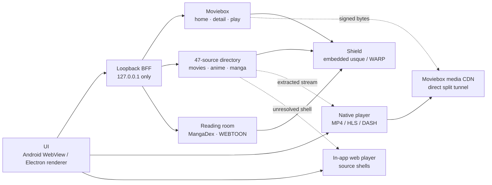

# How SuperBox works

SuperBox ships as two shells around the same idea: a small local server keeps
the UI free of CORS and signing problems, a native player handles real media,
and an embedded VPN carries every proxied request. Provider shells that cannot
be extracted fall back to an in-app web view instead of leaving the app.

## The Shield

`usque` v4.2.1 is an open-source Cloudflare WARP client that speaks MASQUE.
SuperBox embeds it; there is no external VPN app and no account.

| Platform | Engine | Transport into the tunnel |
|---|---|---|
| Windows | hidden `usque.exe l4-http-proxy` on `127.0.0.1:46950` | IPv6 MASQUE anchor (`2606:4700:103::2`) first, IPv4 ladder as fallback; Node `fetch` uses an `undici` proxy agent; Chromium uses `session.setProxy`; loopback bypassed |
| Android | `libusque.so` per ABI, `l4-http-proxy` on `127.0.0.1:46950` | same IPv6-first ladder; `LocalServer` upstream requests use an `HttpURLConnection` proxy; the WebView uses `androidx.webkit` `ProxyController` |

Lifecycle rules that matter:

- The gate blocks the UI until `/api/vpn/status` reports `warp=true`. API calls
  fail closed while the tunnel is down.
- Stopping a tunnel waits for the proxy port to be released — 2.6 s on desktop,
  `Thread.sleep(1200L)` plus 900 ms between endpoint attempts on Android —
  otherwise the next bind fails with `Only one usage of each socket address`.
- Each region has a pool of 12 endpoint profiles. The IPv6 anchor is tried first
  with a 10 s budget: on IPv4-congested networks the IPv4 anchors measured
  2–32 KB/s while the IPv6 path measured 197–415 KB/s. The IPv4 ladder follows,
  starting with `162.159.198.2` and `162.159.199.2`; several other addresses
  fail TLS with `CRYPTO_ERROR 0x128`.
- WARP is anycast. A region selects an endpoint pool, not a guaranteed country.
  Status reports both the requested region and the actual egress.
- Auto-region switching is non-disruptive: a per-source preference is recorded
  and used when the tunnel is down. A healthy tunnel is never restarted just to
  chase a region, because mid-session restarts broke the tunnel during testing.

### Scoped media splits

Moviebox's media CDN (`*.hakunaymatata.com`) rejects WARP egress with
`427 Forbidden`. Its catalogue, API, artwork and source pages stay behind the
Shield; the signed media bytes are fetched directly. nhplayer's r2 CDN
(`*.1hanime.com`), which backs Hentai.tv, throttles WARP the same way, so its
verified media bytes also use the direct route. The split is scoped to those
host patterns only:

- desktop: `MEDIA_DIRECT_RE` plus an `undici` `Agent` for the media request;
- Android: `LocalServer.routeFor()` returns `Proxy.NO_PROXY` for those hosts.

The media request itself still needs `Range`, a valid `Referer` and the
anti-bot `X-Client-Token`. Signed URLs also carry a `t=` timestamp, so a stale
URL is retried from a fresh play response instead of being reused.

Hentai.tv streams are a special case on both platforms: the r2 host answers a
bare mp4 with `403` and only accepts the short-lived `?verify=` token that
nhplayer's `player.php` mints after its fingerprint/PoW challenge (~20 s).
Desktop mounts that page in an offscreen iframe and reads the signed URL from
its `<video>`; Android loads it in a 1×1 offscreen WebView, intercepts the
signed media request (and polls the player DOM as a fallback), then hands the
URL to the native player.

## Android

| Piece | Role |
|---|---|
| `MainActivity.java` | WebView host, immersive player overlay, provider ladder, stall probe and retry, offscreen nhplayer challenge for Hentai.tv |
| `LocalServer.java` | Loopback bridge on ports 47821–47832: packaged assets, token-gated API/image/page/stream proxies, VPN routing, HLS/DASH rewrite, disk cache |
| `VpnManager.java` | Bundled `usque` lifecycle, 13 region pools, port-release waits, status and egress |
| `assets/app.js` | VPN gate, Spotlight UI, search, details, episodes, player controls |
| `assets/reading.js` | MangaDex / WEBTOON catalogue, chapter list and reader |
| `assets/sources-hub.js` | The 47-source directory, grouped and searchable |
| `assets/library.js` | Unified library rows and detail resolution (`window.LIB`) |
| `assets/sources.js` | Library catalogue data (TMDB, AniList, archive.org, XMaal, KatMovieHD, KDramasMaza, live TV, 18+) |
| `assets/libraries.js` | Library scrapers (HTML in, items or streams out) |
| `assets/style.css` | Mobile visual system, including the gold aura and unified library surfaces |
| `assets/vpn-config.json` | Pre-generated WARP registration used to start quickly; runtime registration remains the fallback |

The WebView never talks to the open internet for catalogue calls. Every request
goes through `127.0.0.1`, which adds the client token and referer, routes
through the Shield, and returns clean JSON or media.

Privileged routes (`/api/`, `/page`, `/extract`, `/tmdb/`, `/img`, `/stream`,
`/raw`, `/hls`, `/hlsseg`, `/dash`, `/dashseg`) require a per-session token. The
server injects it into `index.html` as `window.__SB_TOKEN__`, and a small fetch
wrapper signs every same-origin request — relative or absolute — before it
leaves the renderer. Requests without the token get `403`.

First-party scripts are obfuscated during the build. Every `.js` asset is stored
as AES-256-GCM ciphertext (`SBX1` magic, 12-byte IV, 16-byte tag); the key lives
in the generated `BuildSecrets.java`, and `LocalServer` decrypts each file in
memory when the WebView asks for it.

The 1.3.0 APK is a universal fat build. `android/tools/add-native-libs.py`
injects uncompressed `lib/<abi>/*.so` entries for `arm64-v8a`, `armeabi-v7a`,
`x86` and `x86_64` — including `libusque.so` — plus
`assets/ffmpeg/ffmpeg-kit-full-gpl-6.0.LTS.aar` as an on-device decoder archive.
Storing the libraries uncompressed keeps the package above 200 MB and lets the
loader map them without an unpack step.

## Windows

| Piece | Role |
|---|---|
| `desktop/main.js` | Electron window, tray/menu, local server lifecycle |
| `desktop/preload.js` | Narrow IPC bridge |
| `desktop/renderer.js` | Desktop UI, catalogue views, VPN gate, playback |
| `desktop/srv2.js` | Loopback BFF on ports 46901–46903, Moviebox resolver and media proxy, provider extractor, parallel range reader |
| `desktop/vpn.js` | `usque` lifecycle, region pools, truthful status, non-disruptive switching |
| `desktop/reading.js` | MangaDex / WEBTOON catalogue, chapters and reader |
| `desktop/sources-hub.js` | The 47-source directory |
| `desktop/sources.js`, `desktop/libraries.js` | Library catalogue and scrapers |
| `desktop/hls.min.js` | Vendored HLS support |

The parallel range reader matters: some CDNs throttle a single connection to
roughly 60–120 KB/s, and an 8–9 MB MP4 index would otherwise take minutes to
arrive. The proxy splits the range into chunks, fetches them concurrently and
returns a normal `206` in order.

## Reading

`reading.js` exists twice — once for the desktop renderer and once for the
Android WebView — with the same behaviour:

1. MangaDex's API is asked for a catalogue, filtered by genre and age rating.
2. Covers are rewritten from `uploads.mangadex.org` to the working at-home host
   (`https://cmdxd98sb0x3yprd.mangadex.network`), learned once and cached in
   `localStorage` under `sb.md.coverbase`.
3. A chapter with page URLs opens the native vertical/paged reader. Images go
   through `/img`, so they are cached and VPN-routed.
4. A chapter with only an `externalUrl` shows an **External chapter** card with
   the publisher link. WEBTOON chapters can open its own reader in-app.
5. The catalogue retries once after 1.4 s to survive MangaDex rate-limit bursts.

## Rows, artwork and playback

Shelves paint in two stages. A stale-while-revalidate cache
(`sb.rows.v2` on Android, `sb.desktop.rows.v2` on desktop) renders the previous
catalogue immediately, then a shared `IntersectionObserver` starts upstream
work: four rows eagerly, the rest about 700 px before they enter the viewport.
That keeps a 60-row library from firing every request at launch.

Artwork walks local `/img` → origin → `images.weserv.nl`. A card leaves the
placeholder only after all three fail, so transient CDN errors self-heal. The
Android image cache also sniffs magic bytes and rejects an anti-bot HTML page
instead of rendering it as a broken image.

## Playback ladder

1. A library title maps to a provider URL.
2. The native overlay opens the first provider shell.
3. If the shell never delivers media, a stall probe retries once after 12 s,
   then advances to the next provider.
4. A real MP4/HLS/DASH URL plays in the native player. An unresolvable shell
   stays in the in-app web player.

Both players add a progress-aware watchdog. Desktop rotates after 15 s with no
progress (45 s absolute cap); Android uses 18 s and 45 s and adds native
`video.onerror` handling. A direct stream that fails hands off to a `fallback`
URL, then an `embed`, then the provider page. Media listeners and engines are
destroyed between sources so repeated switches do not leak.

Spotlight streams use the catalogue's signed play payload and play natively.
The Android `/raw` path sends the first 2 MB window, then 8 MB follow-ups, with
128 KB chunks and 24 parallel range workers; that keeps a large `moov` atom
from stalling the decoder.

## Privacy model

- No account, no telemetry, no watch history.
- WARP registration is anonymous; `usque` is open source and auditable.
- The proxies bind to `127.0.0.1` and are destroyed with the app.
- Artwork and media are fetched on demand; nothing is re-hosted.
- The Android app requests only internet and network-state permissions.

## Design language

SuperBox uses a near-black surface, a single warm gold light source and the
infinity mark as the app signature. The desktop edition uses the same dark
surface with a lime highlight. Both are built for touch or pointer, with large
targets and restrained motion.
