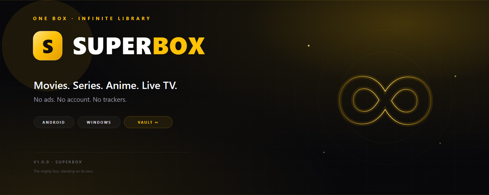

<div align="center">
  
  <h2>SuperBox v1.0.0 — Infinite Aura</h2>
  <p>The first standalone SuperBox release. One brand, two apps, one library.</p>
</div>

## Download

| Build | Platform | Size |
|---|---|---:|
| **SuperBox-Setup-1.0.0.exe** | Windows 10/11 x64 — wizard, any folder/drive | 120.7 MB |
| **SuperBox-Portable-1.0.0.exe** | Windows 10/11 x64 — no install | 109.6 MB |
| **SuperBox-1.0.0.apk** | Android 6.0+ — universal ABI | 145 KB |

`SHA256SUMS.txt` is attached below every artifact.

## Highlights

- **SuperBox Vault** is now its own universe: a separate drawer group, a gold
  infinity hero, ten sections and no sixth bottom tab.
- **Library sources** sheet, reachable from the Vault hero, the drawer and Me.
  TMDB, AniList, archive.org, YouTube, iptv-org, Free-TV, XMaal, KatMovieHD,
  KDramasMaza, HindiDrama and the 18+ Vault are all named.
- **Infinite aura** visual pass: breathing gold glow, aura rings, an `∞`
  watermark, source chips and a premium drawer.
- **Native playback** for real MP4/HLS streams, with a provider ladder that
  probes, retries once after 12 s, then advances past dead shells.
- **Windows Setup** uses a normal wizard and installs to any folder or drive,
  with a no-install portable build alongside it.
- Old library brand names are gone from the shipped UI. The APK text assets
  contain zero old brand strings.

## Verified

- Spotlight: 226 Home cards; Movies 103, Series 115, Anime 26.
- Vault: 5 rows / 104 cards on Home; Web Series 9 rows / 193 titles; Live TV
  17 groups / 200 channels.
- Vault detail, sources and 1080p native playback tested on Android 14.
- Windows installer custom path, finish and installed app tested.
- APK signed with the SuperBox release key:

```
certificate SHA-256: 5a59f92f2526dbdd47b679510ac9ec1754aa479330f304b727997aafa2d82017
```

Full report: [docs/VERIFY.md](https://github.com/mohdziauddin2006-cloud/superbox/blob/main/docs/VERIFY.md).

## Install notes

- **Windows:** SmartScreen may warn because this indie build does not carry a
  paid Windows code-signing certificate. Choose **More info → Run anyway**.
- **Android:** allow “Install unknown apps”, open the APK, install. Play Protect
  may offer to scan the sideloaded app. Android 6.0+ and any ABI.
- **18+:** the adult Vault is opt-in and clearly separated. Adults only.

## Fair use

SuperBox does not host media. It indexes public catalogues and plays streams
from third parties; rights remain with their owners. Use it for personal,
lawful access only, and respect the laws and terms that apply where you live.
